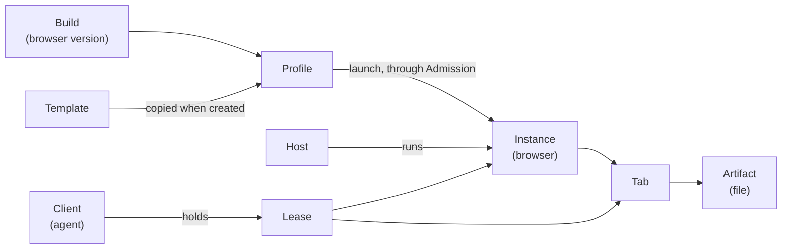

# Concepts

brr uses a small set of words for the things it manages. The same words appear in the CLI, the MCP tools, the REST API and the event log. The web UI uses friendlier names for some of them, shown in brackets in the diagram. [GLOSSARY.md](../../GLOSSARY.md) has the full list.

## From a browser on disk to a page on screen

A Build is one installed copy of a browser at one version: Chrome for Testing 157, a system Chrome, Camoufox. brr can download builds (`brr build install`) or find browsers that are already on the machine (`brr build detect`). Builds belong to one of two engines, the Chromium family or Camoufox, and differ in what they can do. A build without PDF support cannot print to PDF, and the tool says so.

A Profile is a named set of browser settings: which build or release channel to use, display mode, proxy, locale, fingerprint, extensions and limits. A persistent profile also owns one set of browser data (cookies, history, logins) that survives between runs, so only one copy of it can run at a time. An ephemeral profile starts from clean data on every launch and throws it away at the end, so any number of copies can run at once.

A Template is a starting point for new profiles. brr ships four (`chromium-headless`, `chromium-visible`, `camoufox-headless`, `camoufox-stealth`) and you can save your own. A profile copies its template's settings when you create it and does not follow later changes to the template, so a profile that works does not change under you.

An Instance is one running browser. Launching a profile starts an instance. brr can also attach to a browser you started yourself; that is a live instance, which brr never stops, only detaches from. A Tab is one page inside an instance.

## Who is acting, and who may touch what

A Client is whoever acts through brr: an MCP session, one CLI command, a web UI page, a REST caller. A client ends when it disconnects, says so, or goes quiet too long.

A Lease is a client's claim on a tab, or on a whole instance when exclusive. While one agent holds a tab, another cannot drive it. Leases let several agents and a person share one daemon without clicking over each other. When the person takes control in the web UI, the agent's lease is lost and its next call says so.

Each CLI command is its own client. That is why the CLI needs `--tab-id` on every tab command, while an MCP session has a current tab.

## Room to run

brr limits how many browsers and tabs run at once. Admission is the decision made at each launch: start it, put it in a queue, reject it, or make room by closing an idle browser. Limits are either fixed counts (`static`) or based on free memory and CPU load as well (`adaptive`).

brr also closes what nobody uses. A tab or instance with no activity under any lease is idle. After `idle.tab_min` or `idle.instance_min` minutes brr starts a short warning period, and if nothing happens it closes it. You can pin a tab or a profile to keep it open.

## Where browsers run

By default a browser runs on brr's machine as brr's user. With the Docker sandbox each browser gets its own container. A Host is another machine whose Docker brr drives over SSH, so browsers can run there too; they are always containers. A browser in a container reaches the network only through brr. Wherever it runs, you drive it the same way. See [Security model](security.md#sandbox-modes).

## What comes out

An Artifact is a stored output of a tab: a download, or a screenshot, PDF, MHTML or HAR that was too big to return inline or that you asked brr to store. Artifacts live on the storage backend (local disk, S3 or R2), and a retention policy deletes old ones. Small results come back directly in the response instead.

## Logins

A Credential is a stored site login linked to one or more profiles. An agent can ask brr to log in with it but cannot read it: the daemon types the secrets into the page itself. See [Save logins](../how-to/save-logins.md).
