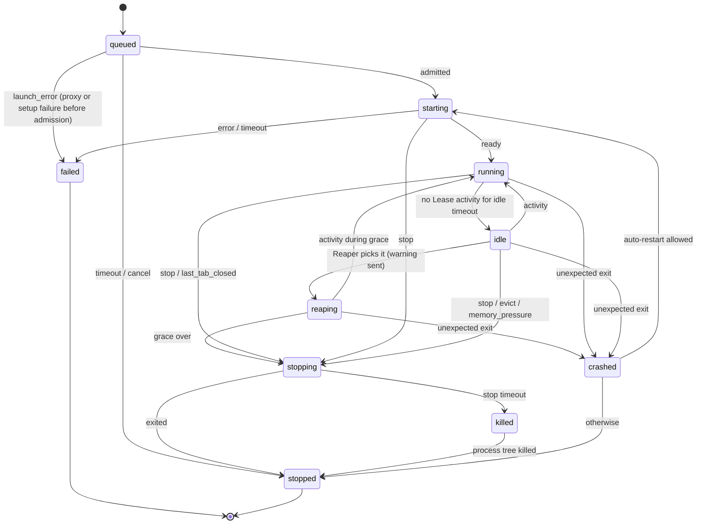
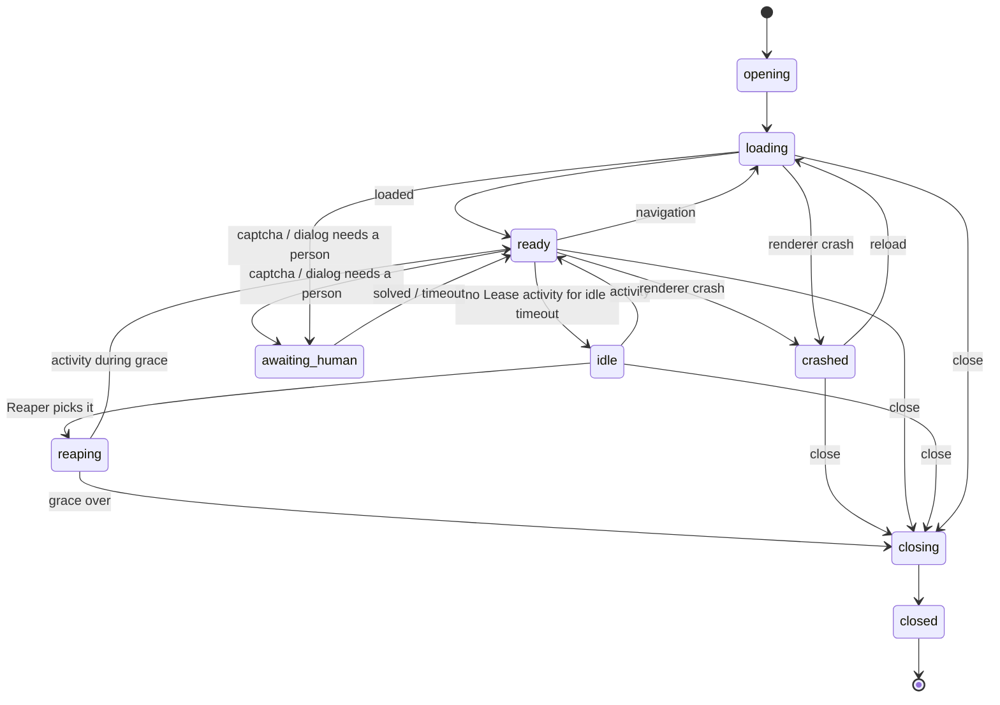
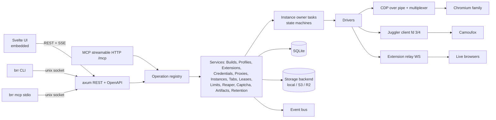

# brr: browser manager requirements (v2)

Status: decisions settled in grilling rounds 1–7. Terms are defined in [GLOSSARY.md](../../GLOSSARY.md). Decision records are in [docs/adr/](../adr/).

## 1. Goal

`brr` is a single Rust daemon. It installs browser Builds, launches Instances from Profiles, tracks their Tabs, reaps what sits idle, and limits load by fixed counts or by available resources. It also attaches to Live browsers. The web UI, REST, MCP and the CLI expose the same operations.

Consumers: AI agents (MCP), scripts (CLI/REST, one-shot URL endpoints), and a person in the web UI who watches and steps in (Human step-in).

## 2. Engines and Builds

Only the Chromium family and Camoufox are supported; stock Firefox is excluded ([ADR 0001](../adr/0001-engines-chromium-family-and-camoufox-only.md)).

| Build source | Engine | How installed |
|---|---|---|
| Chrome for Testing | chromium | CfT JSON API (`known-good-versions-with-downloads.json`) |
| chrome-headless-shell | chromium | CfT JSON API |
| ungoogled-chromium | chromium | release binaries (community-built) |
| fingerprint-chromium | chromium | GitHub releases (trails upstream Chromium) |
| Brave, Microsoft Edge | chromium | vendor packages (download URLs to be verified when implemented) |
| System Chrome, Chromium, Brave, Edge | chromium | detected; registered read-only, not installed by brr |
| Camoufox | camoufox | GitHub releases plus GeoIP database and the `fonts-bundle` release |

- B1. Several versions coexist. A Profile follows a channel (`stable`, `latest-compatible`) or pins a version. Chromium channels check CfT daily. Camoufox moves only to versions that passed the Camoufox compatibility suite (§12). Running Instances keep their version until restarted. A Build source declares its supported (os, arch, version range). On arm64, CfT pins below 153 and the fingerprint-chromium and Edge sources are rejected with `BuildMissing` and the reason (ungoogled-chromium portable and Camoufox ship arm64).
- B2. Build installs verify checksums where the source publishes them, resume interrupted downloads, report progress events, and run at most one at a time per Build.
- B1a. Channels per source: CfT and headless-shell `stable|beta|dev|canary` (CfT `last-known-good-versions`); ungoogled, fingerprint-chromium, Brave and Edge `stable` (latest release); Camoufox `latest-compatible` (newest release that passed R3); system Builds have no channel. When a channel moves, the new version is installed in the background; Profiles on that channel use it at their next launch. A Build is *referenced* while a Profile pins it, it is the current version of a channel some Profile follows, or a non-final Instance uses it.
- B1b. Built-in templates: `chromium-headless` = channel `cft:stable`, falling back to the first detected system Chromium-family Build, display `headless`; `chromium-visible` = same Build, `visible`; `camoufox-stealth` = `camoufox:latest-compatible`, `virtual`, `geoip` on, ad blocking off; `camoufox-headless` = same, `headless`.
- B3. Every Build declares its Capabilities. Profiles and Instances report the Capabilities of their Build.

| Capability | Chromium family | Camoufox |
|---|---|---|
| `pdf`, `mhtml` | yes | no |
| `screencast` (live view) | yes (CDP `Page.startScreencast`) | yes (Juggler `Page.startScreencast`) |
| `unpacked_extensions` | yes: loaded through CDP `Extensions.loadUnpacked` over the pipe (needs `--enable-unsafe-extension-debugging`; branded Chrome ignores `--load-extension` since 137). chrome-headless-shell: no | yes (`.xpi`) |
| `har`, `request_interception` | yes | yes |
| `fingerprint_config` | fingerprint-chromium only | yes |

## 3. Profiles

- P1. A Profile is either a **Persistent profile** or an **Ephemeral profile**.
  - Persistent: its data lives in a local folder under the data root. At most one Instance runs at a time; brr enforces this with its own lock.
  - Ephemeral: named and reusable. Every launch gets fresh data in a temporary folder, and any number of Instances may run at once. Its data is deleted when the Instance stops unless it is **Promoted** to a new Persistent profile first.
- P1a. `instance.promote{instance_id, name}` is allowed on a running or idle ephemeral Instance. It marks the Instance; when the Instance reaches `stopped`, its data folder is moved (not copied) into a new Persistent profile with the Instance's Profile settings, and `profile.created` is emitted. It is refused with `InvalidTransition` from `stopping` onwards.
- P2. A new Profile always starts from a **Profile template**. Built-in templates are `chromium-headless`, `chromium-visible`, `camoufox-stealth` (virtual display) and `camoufox-headless`. Users can save their own templates. A Profile copies its template's settings when created and does not follow later template changes.
- P1b. Before launching a Persistent profile, brr (holding its own lock) removes `SingletonLock`, `SingletonSocket` and `SingletonCookie`. A launch with a Build older than the profile's recorded version is refused with `Conflict{reason:"downgrade"}` unless forced (`launch{force:true}`).
- P3. Profile settings:
  - Build or channel
  - display mode: `headless`, `visible` (desktop window) or `virtual` (Xvfb per Instance, started with `-displayfd` and `-screen 0 <Profile screen WxH>x24`, never 1x1). `visible` needs `DISPLAY` or `WAYLAND_DISPLAY` and fails with a clear error when neither is set
  - proxy or proxy pool
  - locale, timezone, geolocation, viewport and screen, user agent
  - Camoufox fingerprint (OS, screen, fonts, WebGL, `geoip`)
  - WebRTC policy
  - extra launch args, env and browser prefs
  - extensions
  - Credentials
  - Captcha policy
  - ad blocking and cookie-banner dismissal toggles
  - download size limit, Retention and disk-quota overrides
  - idle timeout overrides, Pinned
  - tags and notes
- P4. Cookies: import and export as JSON (storageState) and Netscape `cookies.txt`, for a stopped Profile or a running Instance. brr launches every Chromium-family Build with `--password-store=basic` so that stopped Profiles' cookies can be read and written offline (v10 key).
  - Decision (Camoufox, stopped Profile): Firefox stores no session cookies in `cookies.sqlite`, so a session cookie (`expires` -1) written to a stopped Camoufox Profile is stored as a persistent cookie that expires 400 days later, the cap Chrome applies. The conversion is lossy: reading it back reports that date, not -1. The response of a cookie import into a stopped Camoufox Profile names the number of session cookies converted. A cookie with no SameSite attribute is stored as Firefox's "unset" (256) and reads back as `None`.
- P5. Bookmarks: import and export as HTML. Bookmark import and export require the Profile to be stopped. On a running Instance they fail with `Conflict{reason:"profile_running"}`.
- P6. A whole Profile can be exported and imported as an encrypted archive, downloaded from the UI or written to the Storage backend. Scheduled backups go to the Storage backend, with a per-Profile schedule and a number of copies to keep.
  - Archive = `tar.zst` of the Profile data folder plus `profile.json` (settings, extension refs, login checks; no Credentials), encrypted with `age` using a passphrase given at export (UI prompt, `--passphrase-file` in the CLI). Scheduled backups use a passphrase stored in the `secret` table (`backup.passphrase`). Archives are never encrypted with the machine-bound vault key, so they restore on another machine. Setting it is required before enabling any schedule. Import always creates a new Profile (name suffixed `-1`, `-2`, … on collision; requested and archived names follow the Profile name rules). Archives travel over raw streamed routes, never base64 in memory: `POST /v1/profiles/{id}/export/raw` answers with the archive (`Content-Disposition: attachment`), and `POST /v1/profiles/import/raw[?name=]` takes it as an `application/octet-stream` body, capped at 512 MiB; the passphrase goes in the `X-Brr-Passphrase` header as base64 of its UTF-8 bytes, never in the URL. The JSON `profile.import` op carries base64 and stops at the 48 MiB request limit (the CLI uses the raw routes). Extraction stops at the free space above the disk floor. A Profile being archived cannot be launched, and deleting a Profile deletes its backup objects. Backups of a running Persistent profile are skipped and retried at the next schedule tick, with a `backup.skipped` event. Schedule = `daily@HH:MM` or `weekly@<day>@HH:MM`, local time; `keep` default 7.
  - Deleting a Profile keeps its backups: they stay listed (`backup.list_all`, with the Profile's name as it was and `profile_deleted`), and restore (optional `name` for the new Profile) and delete still work. `settings.get` shows the backup passphrase only as set or unset, never a character of it.
- P7. Disk quota per Profile: launches over the quota are refused and the UI shows why.

## 4. Extensions

- E1. A shared extension library. Sources: the Chrome Web Store by ID or URL (CRX fetched and unpacked), addons.mozilla.org (`.xpi`), and local unpacked folders or `.crx`/`.xpi` files.
- E2. Each Profile enables extensions from the library, each pinned to a version or auto-updated when the Profile launches. Builds without the `unpacked_extensions` Capability reject such Profiles with a clear error. Extensions are installed after launch, before the first Tab opens, on every Chromium-family Build.
- E2a. An extension has an `engine` (chromium for CRX/CWS, camoufox for XPI/AMO). Enabling one on a Profile of another engine fails with `InvalidArgument`. Enabling any extension on a Profile whose Build lacks `unpacked_extensions` fails on save with `EngineUnsupported{capability:"unpacked_extensions"}`. A Profile following a channel is re-checked at launch with the same error. Auto-update queries the CWS update endpoint (`clients2.google.com/service/update2/crx`) or the AMO API v5 at launch, with a 5 s budget; on failure, the installed version is used.
- E3. The brr companion extension can be enabled per Profile.

## 5. Credentials

- C1. A Credential vault. Each entry holds site, username, password, an optional TOTP secret and notes, and is linked to one or more Profiles. Import from Chrome and Firefox password CSV exports.
- C2. Encrypted at rest. The vault key source is chosen once, when the vault is created, and saved in config (`vault.key_source = keyring|file`; `file` = a 0600 key file). brr never re-chooses it and never prompts for an unlock: a locked or missing keyring is a startup error that names the remedy. It never silently creates a new key. Chromium-family Instances always launch with `--password-store=basic`, so Chrome's cookie key does not depend on the environment.
- C3. Agents never read secrets. The `login` operation takes a Credential id, and the daemon fills the username, password and TOTP code itself. Secrets are hidden in logs, events, snapshots and screenshots of filled fields.
- C4. Login checks: each Profile can store a check per site (a URL plus an element or text that proves the session is logged in). The UI shows login status per Profile and site, and a failed check can trigger automatic re-login.
- C1a. Credential fields: `site` (origin, e.g. `https://github.com`; a bare host such as `github.com` is accepted and stored as `https://github.com`), `login_url` (default `site`), `username` (not empty; one Credential per `site` and `username`, a second one fails with `Conflict{reason:"credential_exists"}`), `password`, optional `totp` (`otpauth://` URI or base32 secret; default SHA1, 6 digits, 30 s), optional selectors `username_selector`, `password_selector`, `submit_selector`, `totp_selector`, `notes`.
- C3a. `login` always navigates to `login_url` first, so the form loads in a fresh document; before it types a password or code it checks that the page is still on the site's origin, and `evaluate` stays refused on the Tab for the whole operation. It finds fields by selector, else by `autocomplete=username|current-password|one-time-code`, else by the first visible `input[type=password]` and the preceding text or email input. It handles up to 3 steps (submit, wait for navigation or a new field). It succeeds if the Profile's login check for the site passes, else if the password field is gone after submit. Errors: `LoginFailed{step, reason}`; `Conflict{reason:"credential_not_linked"}` if the Credential isn't linked to the Tab's Profile. Filling uses `Input.insertText` (CDP) or the Juggler equivalent and never `evaluate`.
- C3b. Masking: before any screenshot, screencast frame or snapshot, brr applies `-webkit-text-security:disc` to fields it filled, and snapshots replace their values with `«redacted»`. Redaction (the typed value, and its quoted, HTML- and URL-escaped forms, in every page-sourced string brr returns) prevents accidental disclosure only. The deliberate path is closed separately: while a page holds a secret brr filled, `evaluate` fails with `Conflict{reason:"secret_on_page"}` until the main frame navigates.
- C4a. Login checks run when an Instance reaches `running`, every `login_check.interval` (default 60 min) while running, and on demand. Auto re-login is off by default per check. A check has exactly one of an element or text to look for; one with neither fails. A run opens its own Tab (closed afterwards unless it is the Instance's last, which the Instance owner decides) and records and publishes `login.check_result` once, including after an auto re-login: the login's own success check inside it does not publish. A missed tick waits a full interval rather than catching up, and a Profile's interval ends when its Instance is gone. Backoff: after 3 consecutive failed auto re-logins of a check, auto re-login stops for it until its credential or the check changes, and brr publishes `login.relogin_suspended` once (the count lives in memory, so a restart starts it afresh); until then every interval repeats the attempt.

## 6. Proxies

- X1. Proxy entries: `http`, `https`, `socks5`, with credentials. Bulk import in `host:port:user:pass` format.
- X2. Pools hand out proxies either sticky per Profile or rotated per launch.
- X3. A built-in local forwarding proxy handles authenticated upstreams, because Chromium cannot take proxy credentials from a flag. All engines use the same path.
- X3a. One forwarding proxy listener per Instance on 127.0.0.1, ephemeral port, lifetime of the Instance.
- X4. Health check: exit IP, country, latency. With `geoip`: Chromium sets `TZ` and `--lang`/`LANGUAGE` at launch from the exit IP, geolocation through `Emulation.setGeolocationOverride`, and WebRTC with `--force-webrtc-ip-handling-policy=disable_non_proxied_udp` (Chromium cannot spoof candidate IPs); Camoufox sets timezone, locale, geolocation and WebRTC IPs in the fingerprint config.
- X4a. The GeoIP database is a shared asset installed with the first Camoufox Build or on first `geoip` use; `geoip` is a Profile setting for both engines. Health checks run on proxy creation, hourly, and before launch if the last check is over 1 h old. An unhealthy fixed proxy fails launch with `ProxyUnhealthy`; pools skip unhealthy members and fail with `ProxyUnhealthy` when none is healthy.

## 7. Instances, Tabs, Leases

### 7.1 Leases
- L1. A Client holds Leases. Several Clients may share one Instance, but each Tab is leased to exactly one Client. A Client may ask for an exclusive Lease on an Instance; other Clients then queue. Other Clients' Tabs are visible but read-only (LC4).
- L2. When a Client ends, its Leases are released (LC2).
- L3. Activity means operations under a Lease, commands sent by a Client on a proxied endpoint (browser-to-client events do not count), and human input through live view. Page network traffic, events and timers do not count.

### 7.1a Clients and Leases

- LC1. Client identity. MCP over HTTP is stateless (MCP 2026-07-28 has no sessions): the agent calls `client_create` (returns `client_id`) and passes it as the optional `client_id` argument of every tool; a call without `client_id` is an implicit per-call Client. Exception: tools whose own input is a `client_id` (`client_end`, `lease_list`) take it as that input and run as an implicit Client. Tool errors carry no `structuredContent`; the text is `<code>: <message>` followed by the error body JSON. stdio `brr mcp`: one Client per process. CLI: one Client per invocation. Web UI: one Client per browser (its id is kept in `localStorage`; a load or another tab re-attaches to it while the daemon still has it and creates a new one only when it is gone). Connect endpoint: one Client per WebSocket. REST: callers may send `Brr-Client: <id>` (obtained from `POST /v1/clients`, or any caller-chosen string ≤ 64 chars). Without the header, each request is its own Client.
- LC2. Lease end. A Lease is released when its Client ends: `client_end`, or `client.mcp_http_idle_min` (10) without a call using that `client_id` (MCP HTTP); `brr mcp` process exit (its unix socket closes); CLI process exit; 2 min after the last UI event stream closes (a reload re-attaches before that); connect WebSocket close; `DELETE /v1/clients/{id}`; or (REST with `Brr-Client`) 10 min without a request. An implicit per-call Client (MCP without `client_id`, REST without `Brr-Client`) holds its Leases only for that call.
- LC3. Acquisition. `instance.launch` and `tab.open` return a Lease to the caller. Any tool call on a Tab that has no Lease implicitly acquires one for the caller. A tool call on a Tab leased to another Client fails with `LeaseHeld{client_id}`, unless the tool is read-only.
- LC4. Read-only tools (allowed on any Tab, never acquire a Lease, never count as activity): `tab.list`, `screenshot`, `snapshot`, `get_text`, `get_html`, `get_markdown`, `get_links`, `get_metadata`, `console_messages`, `network_log`, `pdf`, `mhtml`, `cookies_get`, `storage_get`. All other tab tools mutate. A `snapshot` by a Client that does not hold the Tab's Lease returns the tree without refs and never invalidates the holder's refs.
- LC5. Exclusive Lease. `lease.acquire{instance_id, exclusive:true}` waits up to `lease.exclusive_wait` (default 60 s) for the Instance to have no other Client's Leases, then fails with `LeaseHeld`. While it is held, other Clients can't acquire Leases on that Instance and get `LeaseHeld`. Their existing Tab Leases stay but become read-only.
- LC6. Human step-in. The web UI may send live-view input to any Tab while that Tab is `awaiting_human`, or after the user confirms "Take over". While a Tab is `awaiting_human` the UI Client may also run navigation and other non-read-only Tab operations on it without taking it over; its Lease stays with the waiting Client. Taking over transfers the Tab's Lease to the UI Client and emits `lease.transferred`. "Hand back" returns it if the original Client still exists.
- LC7. Connect endpoints. A `/cdp` WebSocket gets an exclusive Lease on its Instance for as long as it is open, and sees only that Instance's targets. brr multiplexes it onto the Instance's single browser connection (T4).
- LC9. Lease lost. A call that runs under a Tab Lease ends with `LeaseLost` as soon as that Lease is released by someone else: `lease.release`, the Client's end, or a take-over (LC6). A Tab closed or an Instance stopped during the call ends it its own way. `instance.stop` by a Client fails with `LeaseHeld` while another Client holds a Lease (exclusive or on any Tab) on the Instance; the web UI Client may always stop. An Instance whose state cannot stop (a Live browser, an ended one) answers `InvalidTransition` first, whatever Leases exist. `instance.stop` with `force: true` (CLI `--force`) overrides this: it releases every Lease on the Instance, so in-flight calls end with `LeaseLost`, and logs the stopping Client.
- LC8. Current Tab. Each Client has a current Tab: the last one it opened or switched to. Tab tools take an optional `tab_id` argument that defaults to the current Tab. REST paths always name the Tab.

### 7.2 State machines

One owner task per Instance applies every transition for that Instance and its Tabs, in order. Transitions are a typed table (§7.2a): an invalid transition is an error. Each Instance transition is saved to SQLite and published on the event bus; Tab transitions are transient except Tab `opened`, `closed`, `crashed` and `awaiting_human`, which are saved too (§12.1). The diagrams below are illustrative; the transition tables in §7.2a are authoritative. Timers belong to a state and are cancelled when it exits.



Live browser Instances: `attaching → attached`; `attached → detached` on `instance.detach`; `attached → lost` when the user closes the browser or the connection drops. brr never kills a Live browser.



Pinned Profiles and Tabs never enter `idle → reaping`.

- S1. Reconciliation on daemon start. Browsers are never adopted: the control pipe died with the daemon, and a closed pipe makes Chromium and Camoufox exit. Every browser is spawned with env `BRR_INSTANCE_ID=<id>` and `BRR_DAEMON=1`, which all descendants (crashpad handlers included) inherit. The daemon sets `PR_SET_CHILD_SUBREAPER`, and browser stdout and stderr go to per-Instance log files. On start, before the first launch, brr scans `/proc/*/environ` of the same uid for `BRR_INSTANCE_ID` and SIGKILLs every match whose Instance is not owned by the current daemon (no stored pid is used, so PID reuse cannot hit another process). Then, for every saved Instance not in `stopped` or `failed`, apply the reconciliation transition `<any non-final> → stopped` (trigger `reconcile`, reason `daemon_restart`), close its Tabs (`closed`), release its Leases (reason `daemon_restart`) and delete its ephemeral data. `queued` Instances also go to `stopped`. Live browser Instances go to `detached`. Persistent profile locks are released. No browser process started by a previous daemon survives a restart. `<any non-final> → stopped` is valid only for the trigger `reconcile`.
- S2. Graceful daemon shutdown: all Instances go to `stopping` in parallel, then are killed after the stop timeout (process group, plus every process carrying the Instance's `BRR_INSTANCE_ID`).

### 7.2a Transition tables

Every Instance row persists `instance.state` plus the listed fields and emits `instance.state_changed{from, to, trigger, reason}`. Tab transitions are transient: they emit `tab.state_changed` (bus only) and update the in-memory state. Only Tab `opened`, `closed`, `crashed` and `awaiting_human` are persisted (events `tab.opened`, `tab.closed`, `tab.crashed`, `tab.awaiting_human`, and the `tab.state` column). Any pair not listed returns `InvalidTransition`.

**Instance (managed)**

| From | To | Trigger (who) | Also persisted / done |
|---|---|---|---|
| — | queued | `instance.launch` (Client) | priority, admission, queued_at; `instance.queued` |
| queued | starting | `admitted` (Admission) | reservation recorded |
| queued | stopped | `queue_timeout` (Admission) / `cancel` (Client stop) | end_reason; caller gets `CapExceeded` |
| queued | failed | `launch_error` (setup before admission, e.g. `ProxyUnhealthy`) | end_reason `launch_error`, error set |
| starting | running | `ready` (driver: browser connected and first page target attached) | pid, started_at |
| starting | failed | `launch_error` / `start_timeout` (owner task) | error; data cleanup if ephemeral |
| starting | stopping | `stop` (Client) | |
| running | idle | `idle_timeout` (owner timer) | |
| idle | running | `activity` (Lease op, connect frame, live-view input) | last_activity_at |
| idle | reaping | `reap` (Reaper) | `instance.reaping_warning` |
| reaping | running | `activity` | |
| reaping | stopping | `grace_over` (owner timer) / `stop` (Client) | |
| idle | stopping | `stop` / `evict` (Admission) / `memory_pressure` (Reaper) | end_reason |
| running | stopping | `stop` (Client, shutdown, or a `/cdp` Client's `Browser.close`) / `last_tab_closed` | end_reason |
| stopping | stopped | `exited` | ended_at, exit code; Leases released; ephemeral data deleted unless promoted |
| stopping | killed | `stop_timeout` | |
| killed | stopped | `tree_killed` | |
| running, idle, reaping | crashed | `unexpected_exit` | exit status; Tabs → closed; Leases released (`instance_crashed`) |
| crashed | starting | `auto_restart` (policy allows) | restart_count++ |
| crashed | stopped | `no_restart` | |
| any non-final | stopped | `reconcile` (daemon start only) | end_reason=`daemon_restart` |

**Instance (live):** `— → attaching` (`instance.attach`); `attaching → attached` (`connected`); `attaching → failed` (`attach_error`/timeout 30 s; a declined dialog gives `Conflict{attach_declined}`, no answer gives `Conflict{attach_unanswered}`; `instance.attach {via:"extension"}` waits 30 s for a companion and gives `Conflict{extension_unanswered}` ("click the brr icon in Chrome and choose Allow and connect"); only `ws://` URLs, `wss://` is rejected); `attached → detached` (`instance.detach` or daemon shutdown); `attached → lost` (browser closed or connection dropped). `detached`, `lost` and `failed` are final; re-attaching creates a new Instance.

**Tab**

| From | To | Trigger |
|---|---|---|
| — | opening | `tab.open` / target created by the page |
| opening | loading | `target_attached` |
| loading | ready | `loaded` (per `wait_until`, default `load`) |
| ready | loading | `navigation` |
| ready | idle | `idle_timeout` |
| idle | ready | `activity` |
| idle | reaping | `reap` (Reaper; skipped for pinned, for `opened_by_brr=false`, and for the Instance's last Tab, I2) |
| reaping | ready | `activity` |
| reaping | closing | `grace_over` |
| ready, loading | awaiting_human | `captcha_needs_human` (K5) / `dialog_blocking` (a `beforeunload` or `alert` arriving while no Client call is waiting and policy is `human`) |
| awaiting_human | ready | `human_done` (UI) / `human_timeout` (300 s; pending call gets `CaptchaFailed`) |
| ready, loading | crashed | `renderer_crash` |
| crashed | loading | `reload` |
| crashed, ready, idle, reaping, loading, awaiting_human | closing | `close` (Client) / `instance_stopping` |
| closing | closed | `target_destroyed` |

### 7.3 Idle and Reaping
- I1. Defaults, all editable in the UI and overridable per Profile: Tab idle 15 min, Instance idle 30 min, reaping grace 60 s.
- I2. The Reaper never closes an Instance's last Tab. Instead, it navigates that Tab to `about:blank` and leaves it `idle`. An exit that follows a `tab.close` of the last Tab requested by brr or a Client is `running → stopping → stopped` (trigger `last_tab_closed`), not `crashed`.
- I3. An Instance's last activity is the latest activity on any of its Tabs or on Instance-level Leases. An Instance becomes `idle` when that is older than the Instance idle timeout, whatever the Tab states.
- I4. `tab.pin`/`tab.unpin` operations exist. Pinned Tabs and Instances of pinned Profiles still become `idle` but are never chosen for reaping, eviction or memory-pressure stops.

### 7.4 Limits and Admission
- A1. Limit mode is switchable at runtime and saved:
  - `static`: maximum Instances total, per Engine and per Profile tag; maximum Tabs per Instance and in total. Instances total, per Engine and Tabs per Instance must be at least 1, as must `retention.download_max_mb`.
  - `adaptive`: admit while `min(MemAvailable, cgroup memory.max − memory.current when inside a container) − Σ reservations − estimate(engine) ≥ adaptive.min_free_ram_mb` and `loadavg_1m / logical_cpus ≤ adaptive.max_load_per_core`; the static maximums still apply as ceilings. Each admitted launch reserves `estimate(engine)` until it has been `running` 30 s. `estimate` is an EWMA of the measured Instance memory (sum of `smaps_rollup` Pss over the processes carrying its `BRR_INSTANCE_ID`) 30 s after `ready`, seeded by `adaptive.reserve_mb` (chromium headless 400, chromium visible/virtual 600, camoufox 600). Admission decisions are serialized.
- A2. Admission when a limit is reached: `queue` by default (timeout 60 s, with priority). Each request may choose `reject` or `evict` instead; `evict` reaps the least-recently-active unpinned idle Instance.
- A2a. If `evict` finds no candidate, the request falls back to `queue`.
- A3. Memory pressure in adaptive mode: reap idle Tabs first, then idle Instances, least recently used first. Pinned items and those with recent Lease activity are never touched.

### 7.5 Data model

SQLite, one file `$XDG_DATA_HOME/brr/brr.db`, WAL mode, migrations via `rusqlite_migration`. Ids are ULID text. Timestamps are integer ms since the epoch. `*_enc` columns are AEAD-encrypted (C2 key). JSON columns are validated by serde types.

| Table | Key columns | Relations / notes |
|---|---|---|
| `build` | id, source (`cft`,`headless_shell`,`ungoogled`,`fingerprint_chromium`,`brave`,`edge`,`system`,`camoufox`), engine, version, channel?, path, state (`installing`,`installed`,`failed`,`registered`), sha256?, size_bytes, capabilities JSON, installed_at, last_referenced_at | unique(source, version) |
| `asset` | id, kind (`geoip_db`,`adblock_list`,`autoconsent_rules`,`device_list`), version, path, updated_at | shared downloads |
| `template` | id, name unique, builtin bool, description? (one plain line: written for built-ins, the source Profile's notes for saved ones), settings JSON (P3 shape) | `template_extension(template_id, extension_id, pinned_version?, auto_update)`, copied into `profile_extension` when a Profile is created from it; removed with the extension |
| `profile` | id, name unique, kind (`persistent`,`ephemeral`), template_id? (informational), template_name? (the Template's name at creation), build_id?, channel?, settings JSON (P3), pinned, notes, data_dir?, disk_quota_bytes?, backup_schedule?, backup_keep, created_at, updated_at | `profile_tag(profile_id, tag)` |
| `extension` | id, engine, source (`cws`,`amo`,`local`), source_ref, name | `extension_version(extension_id, version, path, fetched_at)` |
| `profile_extension` | profile_id, extension_id, pinned_version?, auto_update | PK(profile_id, extension_id) |
| `credential` | id, site, login_url?, username_enc, password_enc, totp_enc?, notes_enc?, selectors JSON, created_at, updated_at | `credential_profile(credential_id, profile_id)` |
| `login_check` | id, profile_id, site, url, expect_selector?, expect_text?, credential_id?, auto_relogin, last_status (`unknown`,`ok`,`failed`), last_checked_at | |
| `proxy` | id, scheme, host, port, username?, password_enc?, healthy?, exit_ip?, country?, latency_ms?, last_error? (one plain sentence from the last failed check), checked_at? | |
| `proxy_pool` | id, name, mode (`sticky`,`rotate`) | `pool_member(pool_id, proxy_id)`, `pool_sticky(pool_id, profile_id, proxy_id)` |
| `instance` | id, kind (`managed`,`live`), profile_id?, build_id?, state, display, priority, admission, pid?, log_path?, cdp_url?, data_dir?, ephemeral, promote_to_name?, restart_count, last_activity_at, queued_at, started_at?, ended_at?, end_reason?, error?, profile_name? (the Profile's name at launch; survives the Profile's deletion, where `profile_id` becomes null); what a managed launch ran with: settings JSON?, template_id?, template_name?, extensions JSON? (`[{id, name, version}]` loaded), proxy_id? (the pool's pick); null for Live browsers | state ∈ §7.2a |
| `tab` | id, instance_id, target_id, state, url, title, opened_by_brr, pinned, last_activity_at, created_at, closed_at? | |
| `client` | id, kind (`mcp`,`cli`,`rest`,`ui`,`connect`), label, current_tab_id?, created_at, ended_at? | |
| `lease` | id, client_id, instance_id, tab_id?, exclusive, acquired_at, released_at?, release_reason? | at most one active lease per tab_id (partial unique index) |
| `artifact` | id, public_id (128-bit random, local URLs), kind (`download`,`screenshot`,`pdf`,`mhtml`,`har`,`html`,`markdown`), profile_id?, instance_id?, tab_id?, mime, size_bytes, backend, location, sha256, created_at | D2 |
| `backup` | id, profile_id (no foreign key: a backup outlives its Profile), profile_name (snapshot), backend, location, size_bytes, created_at | |
| `captcha_solve` | id, ts, profile_id, tab_id, site, type, provider, cost_usd, duration_ms, result, error? | |
| `event` | seq INTEGER PK AUTOINCREMENT, ts, kind, subject_type, subject_id, data JSON | persisted kinds only (§12.1) |
| `secret` | name PK, value_enc, updated_at | provider keys, S3 keys, backup passphrase, proxy passwords (`vault.key_source` bootstrapped in M1) |

The Persistent profile lock (P1) is the invariant "at most one `instance` with that profile_id in a non-final state", enforced inside the owner-task registry and checked in the same transaction that inserts the Instance.

## 8. Tools (REST, MCP, CLI)

Every Tab tool acts on a Tab under the Lease rules of §7.1a. MCP lists every tool of the enabled toolsets (§8.5; default all) and does not filter by Capability. A tool that needs a Capability the Instance's Build lacks fails with `EngineUnsupported{capability}`; the tool-to-Capability map is the Cap marks in §8.3.

| Group | Operations |
|---|---|
| Capture | screenshot (visible area, full page, element, area), PDF, MHTML, HTML, text, Markdown (readability), snapshot with element refs, links and metadata |
| Navigation and input | navigate, back, forward, reload; click, double-click, hover, type, fill, press, select, check; drag; upload; scroll; wait_for (element, text, URL, network idle); handle dialogs; evaluate |
| State and diagnostics | cookies, localStorage and sessionStorage (get, set, clear); console messages; network log; HAR record; emulation (viewport, device, geolocation, timezone, offline, color scheme); request blocking by pattern or type |
| Tabs, Artifacts | list, open, close, switch Tabs; list and fetch Artifacts (Downloads and captures) |
| Logins and captcha | `login(credential_id)`, `solve_captcha`, `await_human` |
| Management | Builds, Profiles, templates, extensions, Credentials, proxies, Instances, Leases, limits, captcha settings, storage, retention, settings, events (`events_watch`) |

- T1. Content cleanup:
  - Markdown and readability: `dom_smoothie` plus an HTML-to-Markdown crate.
  - Ad blocking: Brave's `adblock` crate (single-thread feature off, or one dedicated engine thread), EasyList and EasyPrivacy updated daily. Network rules use `Fetch.enable` on every page, OOPIF and worker session, with patterns for the blocked resource types. The source URL comes from brr's frame tree. A request still unanswered after 500 ms is continued. Cosmetic rules are injected as a stylesheet in the utility world.
  - Cookie banners: DuckDuckGo autoconsent (MPL-2.0, source offered with the binary). Its standalone bundle (rules compiled in) is injected at document start into the utility world of every frame, including OOPIFs (CDP `Page.addScriptToEvaluateOnNewDocument{worldName}`, Juggler `Page.setInitScripts`). If the Playwright bundle is used instead, brr implements the `autoconsentSendMessage`/`autoconsentReceiveMessage` loop (`init`, `eval`, `optOutResult`) through `Runtime.addBinding`.
  - Ad blocking and cookie handling are per-Profile toggles. Stealth templates leave ad blocking off, because interception adds latency and can be detected.
- T2. Shared capture parameters. One schema serves URL query, REST body, MCP arguments and CLI flags:
  - Display: `screen=WxH`, `scale`, `device`, `theme=dark|light`, `reduced_motion`, `locale`, `tz`, `ua`
  - Area: `area=x,y,w,h`, `selector`, `full_page`
  - Waiting: `wait_until=load|domcontentloaded|networkidle`, `wait_for`, `delay`, `timeout`
  - Page cleanup: `hide`, `remove`, `css`, `js`, `block_ads`, `dismiss_cookies` (both ship in M6), `block=image,font,media`
  - Output: `format=png|jpeg|webp`, `quality`, `transparent`
  - PDF: `paper`, `landscape`, `margin`, `pdf_scale`, `pages`, `print_background`
  - Request: `headers`, `cookies`, `profile`, `proxy`, `return=auto|inline|url|both`
- T3. One-shot endpoints: `GET|POST /v1/{screenshot,pdf,mhtml,markdown,content,links}`. GET takes T2 params as query (`headers` and `cookies` as JSON-encoded strings). POST takes a JSON body with the same keys. Without `profile`, the request runs in the built-in Ephemeral profile `oneshot` (created on first start from `chromium-headless`). Each request opens a new Browser context in a `oneshot` Instance, which is taken from the ready pool (setting `oneshot.pool_size`, default 0) or launched through Admission. The Browser context is closed when the response is sent. An Instance with no open contexts stops after `oneshot.linger` (default 60 s). With `profile=<Persistent>`, the request opens a Tab in that Profile's running Instance (or launches it), using the default context. If another Client holds an exclusive Lease, it fails with `LeaseHeld`. Responses: inline results are the raw bytes with their MIME type (`content` → `text/html`, `markdown` → `text/markdown`, `links` → `application/json` array of `{href,text,rel}`). `return=url|both` and results over 5 MB return `200 application/json {artifact_id, url, expires_at, size, mime}`; with `both`, `inline_base64` is added.
- T4. Connect endpoint: `ws://host:9898/cdp?profile=…&display=headless|visible|virtual&proxy=…` (Chromium family). Playwright (`chromium.connectOverCDP`) and Puppeteer (`puppeteer.connect`) can connect without setup. brr owns the only browser connection per Instance (`--remote-debugging-pipe`, fd 3/4; [ADR 0004](../adr/0004-one-pipe-connection-per-instance.md)). Every Client connection, including `/cdp`, is a downstream session that brr multiplexes onto it: brr rewrites message `id`s and routes by `sessionId`. A `/cdp` connection takes an exclusive Lease on the Instance for as long as it is open and sees only that Instance's targets. brr handles `Browser.close` from a `/cdp` Client as that Client's stop request (Instance transition `running → stopping`, trigger `stop`). It answers `Browser.setDownloadBehavior` locally and keeps its own download path. brr's own browser-level session (`Target.setDiscoverTargets` plus auto-attach) stays attached for Tab tracking, and brr resumes every target it auto-attached with `Runtime.runIfWaitingForDebugger` without waiting on Clients. Client WebSockets allow 256 MiB messages and frames. Camoufox has no connect endpoint in v1 (Playwright's `connect()` needs Playwright's server protocol, which ADR 0003 rules out): Camoufox is driven only through brr's own operations (REST, MCP, CLI).
- T5. Results under 5 MB are returned inline. Larger ones are stored as Artifacts and returned as a URL: a presigned URL on S3/R2 (lifetime = min(7 days, `url_ttl`, remaining Artifact retention)), or on local storage a daemon URL containing an unguessable 128-bit random id, valid while the Artifact exists (retention bounds it; no signing). `return` overrides this.
- T5a. Console messages and the network log are in-memory ring buffers per Tab (1000 entries each), discarded when the Tab closes. HAR recordings are stored as Artifacts.
- T6. Element-targeting tools take exactly one of `ref` (from the latest `snapshot` of that Tab; refs are invalid after the next snapshot or navigation and fail with `StaleRef`) or `selector` (Playwright selector syntax via the injected script). `tab.switch` sets the Client's current Tab (LC8) and brings it to the front. `device` names come from Playwright's `deviceDescriptorsSource.json`, vendored at build time. `upload` takes files as uploaded bytes (§13).

### 8.1 Operation naming

Operations are named `<group>.<verb>` (snake_case). MCP tool name = `<group>_<verb>`, except that Tab tools drop the `tab_` prefix (`navigate`, `click`). CLI path = `brr <group> <verb>`, with the verb's kebab-case form. REST follows the route table in §8.2. Each operation declares `read_only: bool` (LC4) and `capability: Option<Capability>`. The registry exposes this metadata in OpenAPI as `x-brr-read-only` and `x-brr-capability`.

### 8.2 REST routes

Errors are `{code, message, details}` (§14). Lists take `?limit&cursor`. Every mutating request accepts the `Brr-Client` header (LC1).

| Method + path | Operation |
|---|---|
| `GET /v1/clients` · `POST /v1/clients` · `DELETE /v1/clients/{id}` | client.list (active Clients with `lease_count`) / client.create / client.end |
| `GET /v1/builds` · `GET /v1/builds/available?source=` · `POST /v1/builds` `{source, version|channel}` · `GET /v1/builds/{id}` · `DELETE /v1/builds/{id}` · `POST /v1/builds/detect` | build.list / available / install / get / remove / detect |
| `GET/POST /v1/templates` (`POST` body takes `extensions`) · `GET/PATCH/DELETE /v1/templates/{id}` · `POST /v1/profiles/{id}/save-as-template` | template.* (a template carries the extensions it hands to new Profiles; `save-as-template` copies the Profile's enabled extensions) |
| `GET/POST /v1/profiles` · `GET/PATCH/DELETE /v1/profiles/{id}` | profile.list / create `{name, template, kind}` / get / update / delete |
| `POST /v1/profiles/{id}/reapply-template` `{dry_run?}` | profile.reapply_template (returns `{changes:[{field, from, to}], extensions:{added, removed}}`; without `dry_run` it copies the template's settings and extensions over the Profile; `Conflict{profile_running}` while it runs, `Conflict{template_gone}` when its template was deleted) |
| `POST /v1/profiles/{id}/launch` `{priority, admission, exclusive, display?}` | instance.launch (returns Instance + first Tab + Lease) |
| `GET/PUT /v1/profiles/{id}/cookies?format=json|netscape` | profile.cookies_export / import |
| `GET/PUT /v1/profiles/{id}/bookmarks` | profile.bookmarks_export / import |
| `POST /v1/profiles/{id}/export` · `POST /v1/profiles/import` (JSON, ≤48 MiB) · `POST /v1/profiles/{id}/export/raw` · `POST /v1/profiles/import/raw` (streamed archive) | profile.export / import |
| `GET /v1/backups` (every backup, newest first, with `profile_deleted`) · `GET/POST /v1/profiles/{id}/backups` · `POST /v1/backups/{id}/restore` · `DELETE /v1/backups/{id}` | backup.* |
| `GET/POST /v1/profiles/{id}/login-checks` · `PATCH/DELETE /v1/login-checks/{id}` · `POST /v1/login-checks/{id}/run` | login_check.* |
| `GET/POST /v1/extensions` · `DELETE /v1/extensions/{id}` · `POST /v1/extensions/{id}/update` | extension.* |
| `GET/POST /v1/credentials` · `PATCH/DELETE /v1/credentials/{id}` · `POST /v1/credentials/import` | credential.* (responses never contain secret fields) |
| `GET/POST /v1/proxies` · `PATCH/DELETE /v1/proxies/{id}` · `POST /v1/proxies/import` · `POST /v1/proxies/{id}/check` | proxy.* |
| `GET/POST /v1/proxy-pools` · `PATCH/DELETE /v1/proxy-pools/{id}` | pool.* |
| `GET /v1/instances?state=&profile=&template=&end_reason=&since=&until=` · `GET /v1/instances/{id}` · `POST /v1/instances/{id}/stop` · `POST /v1/instances/{id}/promote` `{name}` | instance.* (`template` matches a template id or name; `since` inclusive and `until` exclusive, both epoch ms, on the run's time; an Instance also reports the `settings`, `template_id`, `template_name`, `extensions[{id, name, version}]` and `proxy_id` its managed launch ran with, null for Live browsers) |
| `POST /v1/instances/attach` `{cdp_url | install_name | via:"extension"}` · `POST /v1/instances/{id}/detach` | instance.attach / detach |
| `GET /v1/instances/{id}/tabs` · `POST /v1/instances/{id}/tabs` `{url?}` | tab.list / tab.open |
| `GET /v1/tabs/{id}` · `DELETE /v1/tabs/{id}` · `POST /v1/tabs/{id}/switch` · `POST /v1/tabs/{id}/pin` · `POST /v1/tabs/{id}/unpin` | tab.get / close / switch / pin / unpin |
| `POST /v1/tabs/{id}/{tool}` | every Tab tool in §8.3 (e.g. `/navigate`, `/click`, `/screenshot`) |
| `GET /v1/leases` · `POST /v1/leases` `{instance_id, tab_id?, exclusive}` · `DELETE /v1/leases/{id}` | lease.list / acquire / release |
| `GET/PUT /v1/limits` · `GET /v1/admission/queue` | limits.get / set, admission.queue |
| `GET/PUT /v1/captcha/settings` · `GET /v1/captcha/solves` · `GET /v1/captcha/stats?days=` · `GET /v1/captcha/balance?refresh=` | captcha.* (`stats` is per local day, oldest first, 1–30 days, default 7; `balance` is cached for 10 min and returns `fetched_at`) |
| `GET /v1/storage/usage` · `GET/PUT /v1/storage/backend` · `POST /v1/storage/backend/test` | storage.* |
| `GET /v1/artifacts` · `GET /v1/artifacts/{id}` · `GET /v1/artifacts/{id}/content` (local: `GET /v1/a/{public_id}`) · `DELETE /v1/artifacts/{id}` | artifact.* |
| `GET/PUT /v1/retention` · `POST /v1/retention/sweep?dry_run=true|false` | retention.* |
| `GET/PATCH /v1/settings` | settings.get / set |
| `GET /v1/events?since&kinds&limit` · `GET /v1/events/stream` (SSE) | events.list / stream |
| `GET /v1/system/info` · `GET /v1/system/doctor` | system.info / doctor |
| `GET /v1/usage/history?window=1d|7d` | usage.history (Browsers running per bucket by engine: hourly for `1d`, 6-hourly for `7d`; default `1d`) |
| `GET\|POST /v1/{screenshot,pdf,mhtml,markdown,content,links}` | oneshot.* (T3) |
| WS `/v1/tabs/{id}/screencast` · WS `/v1/extension-relay` · WS `/cdp` | live view, companion relay, T4 |
| `/mcp` · `/metrics` · `/openapi.json` · `/` (UI) | |

### 8.3 MCP tools

Tab tools take optional `tab_id` (default: current Tab) and optional `client_id` (LC1). Element tools take `ref` or `selector`. Cap = required Capability. RO = read-only (LC4).

**Tab tools:** `navigate{url, wait_until}`, `go_back`, `go_forward`, `reload`, `click{button, modifiers}`, `dblclick`, `hover`, `type{text, delay}`, `fill{value}`, `press_key{key}`, `select_option{values}`, `check`, `uncheck`, `drag{to_ref|to_selector}`, `upload_file{files[]}`, `scroll{dx, dy | into_view}`, `wait_for{selector|text|url|network_idle, timeout}`, `handle_dialog{accept, prompt_text}`, `evaluate{expression}`, `screenshot` (RO, T2 params), `pdf` (RO, Cap pdf), `mhtml` (RO, Cap mhtml), `get_html` (RO), `get_text` (RO), `get_markdown` (RO), `snapshot` (RO), `get_links` (RO), `get_metadata` (RO), `cookies_get` (RO) / `cookies_set` / `cookies_clear`, `storage_get{area: local|session}` (RO) / `storage_set` / `storage_clear`, `console_messages` (RO), `network_log` (RO), `har_start` / `har_stop` (Cap har → Artifact), `emulate{viewport, device, geolocation, timezone, offline, color_scheme}`, `block_requests{patterns, types}` (Cap request_interception), `tab_list` (RO), `tab_open{url}`, `tab_close`, `tab_switch`, `tab_pin` / `tab_unpin`, `artifact_list` (RO), `artifact_fetch{id, return}` (RO), `login{credential_id}`, `solve_captcha`, `await_human{reason, timeout}`.

**Management tools:** `client_list`, `client_create`, `client_end`; `build_list`, `build_available`, `build_install`, `build_remove`, `build_detect`; `template_list|get|create|update|delete`; `profile_list|get|create|update|delete|launch|reapply_template`, `profile_cookies_export|import`, `profile_bookmarks_export|import`, `profile_export|import`, `backup_list|list_all|create|restore|delete`, `login_check_list|create|update|delete|run`; `extension_list|add|remove|update`; `credential_list|create|update|delete|import`; `proxy_list|create|update|delete|import|check`, `pool_list|create|update|delete`; `instance_list|get|stop|promote|attach|detach`; `lease_list|acquire|release`; `limits_get|set`, `admission_queue`, `usage_history`; `captcha_settings_get|set`, `captcha_solves`, `captcha_stats`, `captcha_balance`; `storage_usage`, `storage_backend_get|set|test`; `retention_get|set|sweep`; `settings_get|set`; `events_watch`; `system_info`, `system_doctor`; `oneshot_screenshot|pdf|mhtml|markdown|content|links`.

### 8.4 CLI tree

```
brr daemon run | start | stop | status | install | uninstall | logs
brr mcp [--toolsets a,b]     # stdio MCP, auto-starts daemon; default toolsets from `mcp.default_toolsets` (§8.5)
brr doctor
brr prime                    # agent guide + what runs now; never starts the daemon
brr skill [install [--dir <skills folder>]...]   # print or install skills/brr/SKILL.md (default ~/.claude/skills, ~/.agents/skills)
brr version | completion <shell>
brr build list | available [--source] | install <source> [--version|--channel] | remove <id> | detect
brr template list | get | create | update | delete
brr profile list | get | create <name> --template <t> [--ephemeral] | update | delete | launch <name> [--priority --admission --exclusive --display]
brr profile reapply-template <name> [--dry-run]
brr profile cookies export|import <name> [--format json|netscape] [-o|-i path]
brr profile bookmarks export|import <name>
brr profile export <name> -o file --passphrase <file> | import --file <archive> --passphrase <file>
brr backup list | list-all | create | restore | delete
brr login-check list | create | update | delete | run
brr extension list | add <cws-id|amo-slug|path> | remove | update
brr credential list | create | update | delete | import <csv>
brr proxy list | create | update | delete | import <file> | check <id>
brr pool list | create | update | delete
brr instance list [--state --profile --template --end-reason --since --until] | get | stop | promote <id> --name | attach (--cdp-url|--install-name|--extension) | detach
brr tab list [--instance] | open | close | switch | pin | unpin
brr client list | create | end
brr tab <tool> --tab-id <id> [args]  # navigate, click, screenshot -o file, … (every §8.3 Tab tool)
brr lease list | acquire | release
brr limits get | set
brr captcha settings get|set | solves | stats [--days] | balance [--refresh]
brr usage history [--window 1d|7d]
brr storage usage | backend get|set|test
brr artifact list | get | fetch <id> -o file | delete
brr retention get | set | sweep [--dry-run]
brr settings get | set <key> <value>
brr events [--follow] [--kinds] [--since]
brr shot screenshot|pdf|mhtml|markdown|content|links <url> [T2 flags] [-o file]
```
`tab.take_over`, `tab.hand_back` and `tab.human_done` belong to the web UI (REST with a UI Client; any other Client gets `InvalidArgument` on `client`): they have no CLI command and no MCP tool.

Output is human-readable by default; `--json` prints the operation's typed output. Exit codes come from §14.

### 8.5 MCP toolsets

MCP tools are grouped into toolsets: `browser` (Tab tools and `tab.*`, one-shot tools), `instances` (client, instance, lease, limits, admission, usage), `profiles` (template, profile, backup, login_check, extension), `builds`, `network` (proxy, pool), `credentials`, `captcha` (captcha settings, solves, stats, balance), `storage` (storage, retention), `system` (settings, events, system). Select toolsets with `brr mcp --toolsets=a,b` and HTTP `/mcp?toolsets=a,b`. Without that, the setting `mcp.default_toolsets` applies to both (the daemon reads it for HTTP; `brr mcp` reads it for stdio). Its default is all toolsets, so MCP lists every tool unless the user narrows it; an empty list is `InvalidArgument{field: mcp.default_toolsets}`.

## 9. Captcha

- K1. Off until an API key is set. Default Captcha policy is then `auto` (detect, then solve); per Profile it can be `off`, `on-demand`, `auto` or `human`.
- K1a. `off`: no detection. `on-demand`: detection only; solving runs only when a Client calls `solve_captcha`. `auto`: detect and solve. `human`: detect, then go straight to `awaiting_human`. Budgets reset at 00:00 in the daemon's local time zone. The provider API key is stored in the `secret` table.
- K2. Detection: reCAPTCHA v2 and v3, hCaptcha, Turnstile, FunCaptcha, GeeTest, image captchas.
- K3. Solving goes through a provider interface; 2captcha is first. The Profile's upstream proxy (not the local forwarder) is passed so tokens match the site's view of the IP; Profiles without a proxy use proxyless tasks.
- K4. Daily limits, editable in the UI: $5 and 200 solves (defaults). Every solve is logged with site, type, cost, duration and result; the UI shows the balance. `captcha.stats` returns spend, solves and failures per local day (1–30 days, default 7, oldest first, zeros for days without a solve). `captcha.balance` asks the provider at most once per 10 min: it caches the answer with `fetched_at`, `refresh` forces a new request, and setting a new API key clears the cache.
- K5. Fallback when a solve fails, the type is unsupported, or the budget is exhausted: the Tab goes to `awaiting_human`. The caller waits up to 5 min, then gets `CaptchaFailed`.

## 10. Live view and Live browsers

- V1. Chromium: CDP screencast with mouse and keyboard forwarding, in every display mode. Frames stop until each `Page.screencastFrameAck`; brr acks once per frame. Each brr-opened Tab gets its own window (`Target.createTarget{newWindow:true}`), and Chromium launches with `--disable-backgrounding-occluded-windows --disable-renderer-backgrounding --disable-background-timer-throttling`. One screencast per Tab fans out to all viewers. Input is scaled from frame pixels to CSS pixels using `metadata.deviceWidth` and `pageScaleFactor`, with a key mapping (`key`, `code`, `windowsVirtualKeyCode`, `text`) or `Input.insertText` for IME. JS dialogs, `<select>` popups, permission prompts and HTTP auth are not in the frames: the UI shows JS dialogs and answers them with `Page.handleJavaScriptDialog`.
- V2. Camoufox: Juggler screencast (`Page.startScreencast`, `Page.screencastFrame`, `Page.screencastFrameAck`) with mouse and keyboard forwarding (`Page.dispatchMouseEvent`, `dispatchKeyEvent`, `dispatchWheelEvent`, `insertText`), in every display mode, through the same live-view protocol as Chromium. A `virtual` display is Xvfb started with `-displayfd` and `-screen 0 <Profile screen WxH>x24`. Xvfb is a system package checked by `brr doctor`; the Docker image includes it.
- V3. Live browsers (Chromium family):
  - Via a CDP endpoint, or by install name (`chrome`, `chrome-beta`, …), reading `DevToolsActivePort` after the user enables chrome://inspect/#remote-debugging. Chrome 136+ ignores `--remote-debugging-port` on its default profile.
  - Via the brr companion extension, built like Playwright's extension and `cdpRelay`: `chrome.debugger` per tab, with a tab group marking which tabs a Client controls, and a WS relay in the daemon that translates browser-level CDP. The extension asks the user for consent per connection.
  - brr opens exactly one browser WebSocket per Live browser (built from `DevToolsActivePort`) and multiplexes all Clients over it. In Chrome 144+ approval mode (the chrome://inspect toggle) `/json/*` returns 404, page sockets return 403, only the browser socket works, and every new WebSocket shows an "Allow remote debugging?" dialog; the Tab shows a "controlled by automated test software" banner. The connect timeout is 30 s; brr never retries automatically, and declined and unanswered are reported as different errors. On Live browsers brr uses `Target.setDiscoverTargets` and attaches only to leased Tabs, never with `waitForDebuggerOnStart`.
  - Limits of the extension route: a "being debugged" infobar; no `chrome://` pages; it detaches when DevTools opens.
  - brr never kills a Live browser. Reaping applies only to Tabs brr opened.
- V3a. A Live browser Instance has no Profile, kind `live`, Capabilities of the matching detected system Build (else the Chromium-family defaults without `unpacked_extensions`), and does not count toward limits or Admission. CDP-endpoint and install-name attaches expose all existing page targets as Tabs with `opened_by_brr=false`; the extension route exposes only tabs in the brr tab group. Tabs with `opened_by_brr=false` are never reaped. `DevToolsActivePort` paths: `~/.config/google-chrome`, `~/.config/google-chrome-beta`, `~/.config/chromium`, `~/.config/BraveSoftware/Brave-Browser`, `~/.config/microsoft-edge`.

## 11. Storage and retention

- D1. Storage backend for Artifacts and Profile backups: `local` (default), S3-compatible (endpoint, region, bucket, keys, path-style), or Cloudflare R2 (preset: account ID gives the endpoint, region `auto`, no object ACLs). An optional `storage.public_endpoint` is used only for presigning, because SigV4 signs the `Host` header (R2 presigned URLs work only on `<account>.r2.cloudflarestorage.com`). With `aws-sdk-s3`, set `request_checksum_calculation = WhenRequired`. Set in the UI, with a connection test. Profile data always stays on local disk. Objects stay tied to the store they were written to: the key of every object on an S3 or R2 backend starts with a short tag derived from its endpoint and bucket, and an Artifact or backup is read, presigned, restored or deleted only while the current backend's tag matches. After switching to another bucket or endpoint (even of the same kind), reading or restoring the old objects is refused with a message to switch back, and `backup.delete` is refused too; deleting an Artifact drops its row and logs that the object stays in the old store, because its credentials are gone. S3 transfers have no total timeout (a large backup may take minutes); only connect and an idle (stalled) read are bounded. At startup the daemon clears leftover scratch files from `data_dir/tmp`, unfinished extension staging directories and unrenamed storage temp files.
- D2. Every Artifact is recorded in SQLite (owner Profile and Instance, kind, size, location, created_at) so sweeping never has to list the bucket.
- D3. The Storage page shows disk usage per Profile, Build, extension and Artifact, with browse and delete.
- D4. Retention rules, global defaults (editable in the UI, some overridable per Profile):

| Item | Rule | Default |
|---|---|---|
| Artifacts | maximum age; above total size, oldest deleted first | 7 days, 10 GB (per Profile override) |
| Download size | a Download over the limit is cancelled | 2 GB (per Profile override) |
| Profile disk quota | launch refused when over quota | none (per Profile) |
| Free disk floor | no launches or Downloads below it | 5 GB |
| Ephemeral leftovers | deleted | at startup and hourly |
| Unused Builds and extensions | deleted after N days unreferenced | 30 days |
| Events and captcha solve log | deleted by age | 30 days |
| Finished Instances (with their Tabs), released Leases, ended Clients | deleted by age at daemon start | 30 days |
| Profile backups | number of copies kept | per Profile schedule |

A sweep runs hourly and on demand ("Clean now"), with a preview of what would be deleted.

## 12. Architecture

Pure Rust, no sidecar ([ADR 0003](../adr/0003-pure-rust-no-sidecar.md)).



- R1. **Operation registry.** Each operation is defined once, with typed input and output and a description. REST routes with OpenAPI, MCP tools and `brr` CLI commands are generated from it. The Svelte client is generated from the OpenAPI spec with `openapi-typescript` plus `openapi-fetch`. A test fails if any operation is missing from a surface.
- R2. **Drivers** sit behind one interface (launch, attach, targets, input, capture, intercept, cookies, close) and declare Capabilities.
  - The Chromium driver uses our own thin CDP client over the pipe: `serde_json` params with small typed structs only for responses brr reads. Chromium launches with `--remote-debugging-pipe`, `--password-store=basic` and `--enable-unsafe-extension-debugging`; extensions load through `Extensions.loadUnpacked` (not on chrome-headless-shell).
  - One pipe transport serves both engines (Chromium `--remote-debugging-pipe`, Camoufox `-juggler-pipe`: fd 3 in, fd 4 out, `\0`-delimited), set up with the `command-fds` crate.
  - The Camoufox driver uses our own Juggler client plus a Rust port of the Camoufox TypeScript launcher at the pinned tag (`typescript/src/{utils,fingerprints,coherence,webgl,locales,addons}.ts`). Fingerprints come from the fpgen model pinned by Camoufox's `fpgen-model.json` (download, verify sha256, zstd). The config is passed as `CAMOU_CONFIG_1..N` and `CAMOU_PREFS_1..N` chunks of ≤32 767 code points. `FONTCONFIG_FILE` is generated per target OS, and the fonts bundle is installed with the Build. Runtime prefs go through Juggler `Browser.enable{userPrefs}`. The port is checked against outputs recorded by Camoufox's `typescript/scripts/golden` for fixed inputs. Juggler changes with Playwright minor versions (Camoufox pins `playwright<1.63`).
  - Browser stdout and stderr go to per-Instance log files, never pipes. The daemon sets `PR_SET_CHILD_SUBREAPER` (S1).
- R2a. **Automation core** (Rust, per driver, both engines): the frame tree with a `frameSeq` per frame; one utility world per frame (`Page.createIsolatedWorld`; Juggler `worldName`); Playwright's injected script (Apache-2.0), built standalone with bun or esbuild at brr build time from the pinned Playwright tag and embedded with its NOTICE. Element actions follow Playwright's `_retryPointerAction`, ported to Rust: resolve the ref, check states (visible, stable, enabled, receives events), scroll into view, take content quads, add the OOPIF frame offset, check the hit target, then dispatch input; retry until the timeout. A ref from an older snapshot or a navigated frame fails with `StaleRef`.
- R3. **Camoufox compatibility suite**: launch, navigate, snapshot, input, screencast, cookies, interception and screenshot, run against each new Camoufox release. Passing it is what makes the release `latest-compatible`.
- R4. Crates: the approved list in `AGENTS.md`. Notable choices: axum (HTTP, SSE, WS; WS limits raised to 256 MiB), rmcp (MCP, pinned), command-fds, age, rusqlite (bundled), object_store (S3/R2 presign), rust-embed, reqwest (CfT, 2captcha, CLI over the unix socket), dom_smoothie + htmd, adblock, clap. Memory and load come from `/proc/meminfo`, `/proc/loadavg`, `/proc/<pid>/smaps_rollup` and cgroup v2 `memory.max`/`memory.current`, with no extra crate.
- R5. Config is `$XDG_CONFIG_HOME/brr/config.toml`, with env overrides; UI changes write back to it. Data lives in `$XDG_DATA_HOME/brr/`. Single daemon per user, enforced by a lock file.
  - `config.toml` holds global settings only (§20 keys). SQLite holds every entity and runtime state. UI edits to global settings rewrite `config.toml` with `toml_edit`, keeping comments. A key set by an env override (`BRR_<SECTION>__<KEY>`) is shown read-only in the UI with its source. Secrets (captcha provider API keys, S3/R2 secret keys, proxy passwords, Credential fields) are never stored in `config.toml`. They live in the encrypted `secret` table (same key as C2) and are never returned by any surface. Reads return `{set: true, hint: "…last 4"}`.
- R6. MCP transports: streamable HTTP at `/mcp`, plus `brr mcp` over stdio, which starts the daemon if needed and forwards to it. The MCP service is built with `disable_allowed_hosts()` and an empty `allowed_origins` (ADR 0002), because rmcp's default host allow-list returns 403 on a non-loopback bind. When `brr mcp` starts the daemon, it starts it through `systemctl --user start brr` if the unit is installed, otherwise with double fork, `setsid` and stdio redirected to the log, so the daemon outlives the agent's process tree and never inherits the MCP stdio. It then waits for the socket.
- R7. Observability: structured JSON logs, the event log, and `/metrics` in Prometheus format (Instances, Tabs, RSS, queue depth, captcha spend, storage).
- R8. Events have a monotonic `seq`. `GET /v1/events/stream` is SSE with `id: <seq>`, and it honors `Last-Event-ID` and `?kinds=a,b&subject=<type>:<id>`. `GET /v1/events?since=<seq>&limit=` pages history. The MCP tool `events_watch{since, kinds, timeout_ms ≤ 30000}` long-polls and returns `{events, next_since}`. Events marked *transient* in §12.1 are not persisted. A slow SSE subscriber whose 1024-event buffer overflows is sent `event: lagged` and disconnected.
- R9. The CLI and `brr mcp` talk HTTP/1.1 over `$XDG_RUNTIME_DIR/brr/brr.sock` (same routes as TCP). All CLI commands except `daemon *` and `doctor` start the daemon (detached) if the socket is absent, waiting up to 10 s. Daemon lock: `$XDG_DATA_HOME/brr/daemon.lock` (flock), in the data dir so two daemons on one data dir always conflict. S3: `object_store` crate (`aws` feature). SQLite: `rusqlite` + `rusqlite_migration`, accessed from a dedicated blocking thread pool. `brr doctor` checks: data and config dirs writable, socket and port free, keyring available, Xvfb on PATH, `DISPLAY` or `WAYLAND_DISPLAY` set (for `visible`), `/dev/shm` size, sandbox policy, at least one Chromium-family Build, free disk vs floor, `/dev/shm` ≥ 512 MB, user namespaces (Chromium sandbox), Docker detection. Metrics: `brr_instances{state,engine}`, `brr_tabs{state}`, `brr_instance_rss_bytes{instance}`, `brr_admission_queue_depth`, `brr_captcha_spend_usd_total`, `brr_captcha_solves_total{result}`, `brr_storage_bytes{kind}`, `brr_leases{client_kind}`.

### 12.1 Event catalog

Envelope: `{seq, ts, kind, subject:{type,id}, actor_client_id, data}`; `actor_client_id` is the Client whose call caused the event, null for what the daemon does on its own (reaper, crashes, schedules). *T* = transient (bus and SSE only, not persisted).

| Kind | data |
|---|---|
| `instance.state_changed` | `{instance_id, profile_id?, from, to, trigger, reason?}` (trigger ∈ §7.2a) |
| `instance.queued` | `{instance_id, queue_pos, priority}` |
| `instance.reaping_warning` | `{instance_id, grace_ends_at}` |
| `tab.opened` / `tab.closed` | `{tab_id, instance_id, url, opened_by_brr}` / `{tab_id, reason}` |
| `tab.state_changed` (T) | `{tab_id, instance_id, from, to, trigger}` |
| `tab.crashed` | `{tab_id, instance_id}` |
| `tab.reaping_warning` | `{tab_id, grace_ends_at}` |
| `tab.awaiting_human` | `{tab_id, reason: captcha|dialog|login, deadline}` |
| `tab.navigated` (T) | `{tab_id, url, title}` |
| `client.created` / `client.ended` | `{client_id, kind, label}` / `{client_id, reason}` |
| `lease.acquired` / `lease.released` / `lease.transferred` | `{lease_id, client_id, instance_id, tab_id?, exclusive}` / `+reason` / `{lease_id, from_client, to_client}` |
| `admission.decided` | `{instance_id, outcome: admitted|queued|rejected|evicted, inputs:{free_ram_mb, reserved_mb, load_per_core, counts}}` |
| `system.memory_pressure` | `{free_ram_mb, action, target_id}` |
| `build.install_progress` (T) | `{build_id, bytes, total?}` |
| `build.installed` / `build.install_failed` / `build.removed` / `build.channel_moved` | `{build_id, source, version}` / `+error` / … / `{source, channel, from, to}` |
| `profile.created` / `profile.updated` / `profile.deleted` | `{profile_id, name}` |
| `extension.updated` | `{extension_id, from, to}` |
| `download.started` (T) / `download.completed` / `download.cancelled` | `{tab_id, artifact_id?, filename, size, reason?}` |
| `artifact.created` / `artifact.deleted` | `{artifact_id, kind, size, reason?}` |
| `retention.sweep_completed` | `{dry_run, deleted:{artifacts, builds, extensions, events, backups}, bytes}`; published only by a real sweep, so `dry_run` is always false |
| `backup.completed` / `backup.failed` / `backup.skipped` | `{profile_id, backup_id?, error?}` |
| `captcha.detected` / `captcha.solved` / `captcha.failed` / `captcha.budget_exhausted` | `{tab_id, site, type}` / `+cost_usd, duration_ms` / `+error` / `{spent_usd, solves}` |
| `login.performed` / `login.check_result` / `login.relogin_suspended` | `{tab_id, credential_id, ok, step?}` / `{profile_id, site, status}` / `{profile_id, site, failures}` |
| `proxy.health` | `{proxy_id, healthy, exit_ip?, country?, latency_ms?}` |
| `limits.changed` / `settings.changed` | `{keys}` |

Credential secrets never appear in `data` (C3). Acceptance test: grep every event, log line and response from a login run for the plaintext password.

## 13. Security

- No authentication and no Host or Origin checks ([ADR 0002](../adr/0002-no-auth-no-request-origin-checks.md)), except `WS /v1/extension-relay`, which accepts only `chrome-extension://` and `moz-extension://` Origins (403 otherwise) so a web page cannot pose as the companion. Binds 127.0.0.1:9898 by default; address and port are configurable.
- Credentials are encrypted at rest and never returned through any surface (§5).
- Profile backup archives are encrypted with a passphrase (age).
- API file paths are confined to the data root.
- No operation takes a host file path as input. File inputs are uploaded: REST `multipart/form-data` or base64 in JSON; MCP base64 argument; the CLI reads local paths and uploads them (`brr tab upload-file --files <path>...` builds one `{name, data}` item per path). A local unpacked extension folder is uploaded as a tar stream by the CLI and copied into the library. File outputs are returned as bytes or Artifact URLs; the CLI writes them with `-o <path>`. A JSON file input or output is capped at 48 MiB (the same cap for upload and `profile.export`); larger archives use `profile export` over the raw streaming route or `destination: storage`.
- CLI flags reach every input value. A boolean flag is true when given (`--pinned`) and false with an explicit value (`--pinned=false`); a required boolean must be given one way or the other. An optional field that accepts `null` also has `--clear-<name>`, which sends `null` to unset it (`--clear-disk-quota-bytes`); it conflicts with setting the same field.

## 14. Errors

Typed errors are shared by all surfaces. Each maps to an HTTP status, an MCP `isError` result with a code, and a stable CLI exit code:

| Code | HTTP | Exit | When |
|---|---|---|---|
| `InvalidArgument{field}` | 400 | 2 | validation failure, engine/extension mismatch |
| `NotFound` | 404 | 3 | |
| `Conflict{reason}` | 409 | 4 | `profile_locked`, `profile_running`, `downgrade`, `credential_not_linked`, `template_gone` (`profile.reapply_template` on a Profile whose template was deleted or never set), name taken |
| `InvalidTransition{from, to}` | 409 | 5 | |
| `LeaseHeld{client_id}` | 423 | 6 | Tab or Instance leased by another Client |
| `LeaseLost` | 410 | 7 | Lease released during the call |
| `CapExceeded{retry_after|queue_pos}` | 429 + `Retry-After` | 8 | |
| `QuotaExceeded{scope: profile|disk_floor, used_bytes, limit_bytes}` | 507 | 9 | P7 quota, free disk floor (for `disk_floor`, `used_bytes` is the free space and `limit_bytes` the floor) |
| `DownloadTooLarge` | 413 | 10 | |
| `BuildMissing` | 424 | 11 | |
| `EngineUnsupported{capability}` | 422 | 12 | |
| `DependencyMissing{name}` | 503 | 13 | Xvfb, keyring |
| `ProxyUnhealthy` | 502 | 14 | |
| `NavigationFailed{net_error}` | 502 | 15 | |
| `ElementNotFound` / `StaleRef` | 422 | 16 | |
| `EvaluationFailed{message}` | 422 | 17 | |
| `LoginFailed{step, reason}` | 422 | 18 | `reason` is one of `no_form`, `rejected`, `no_totp_secret`, `not_logged_in`; each has a fixed message, never page text |
| `CaptchaBudgetExceeded` | 402 | 19 | |
| `CaptchaFailed` | 422 | 20 | |
| `StorageUnavailable` | 503 | 21 | backend error |
| `Timeout` | 504 | 22 | |
| `Internal` | 500 | 1 | |
| CLI only: daemon unreachable | — | 69 | |

REST body: `{code, message, details}`. MCP: `isError: true` and `content[0].text = "<code>: <message>"` followed by the error body JSON; tool errors carry no `structuredContent` (LC1). A validation error names the offending field exactly as the request spells it (`details.field`, a dotted path inside nested input such as `geolocation.latitude`); an unknown key at any level of the input is an `InvalidArgument` too, and so is a parameter the browser itself rejects as invalid. `tab.open` and `lease.acquire` on an ended Instance fail with `InvalidTransition{from: <its state>}`; `tab.login` with an unknown Credential id is `NotFound`; ending an ended Client is a no-op that succeeds; deleting a Credential unlinks it from its Profiles. `tab.emulate` geolocation needs latitude within ±90, longitude within ±180 and accuracy of at least 0; `tab.cookies_get` urls must be absolute URLs. Malformed MCP requests are JSON-RPC errors: not JSON is `-32700`, a `tools/call` without a string `name` or with non-object `arguments` is `-32602`, both HTTP 400. URLs given to `tab.navigate`, `tab.open` and `instance.launch` must be absolute with scheme `http`, `https`, `file`, `about`, `data` or `chrome`, and a storage `endpoint` must be an absolute `http(s)` URL; anything else is `InvalidArgument{field: url|endpoint}`.

## 15. Platform and distribution

Linux x86_64 and arm64. Shipped as one binary, with `brr daemon install` writing a systemd user service (with `PassEnvironment=DISPLAY WAYLAND_DISPLAY XDG_RUNTIME_DIR`), plus a Docker image (with Xvfb and `tini` as init) for servers. The Docker image documents `--shm-size=2g`, launches Chromium with `--disable-dev-shm-usage`, and documents a sandbox policy (`--no-sandbox` or a seccomp profile allowing user namespaces). With `sandbox.mode = docker` each managed browser instead runs in its own container with no network but brr's forwarder ([ADR 0005](../adr/0005-browser-sandbox-modes.md), [sandbox spec](2026-11-17-browser-sandbox.md)). Process and path handling stay portable for a later macOS port. `brr doctor` checks all of these.

## 16. Out of scope (v1)

Profile sync between machines, multiple users and logins, a cluster of daemons sharing limits, Windows, macOS, stock Firefox, recording and replay, a mobile device farm, a Playwright-protocol connect endpoint for Camoufox (would need a Playwright server; see ADR 0003), whole-display VNC (possible later via TigerVNC Xvnc).

## 17. Milestones

1. **Core.** Registry with naming rule and metadata; SQLite schema and migrations (§7.5); config, lock and socket (R5, R9); event bus, SSE and the persisted event log; state machines (§7.2a); Clients and Leases (LC1–LC8); Chromium driver over the pipe with the CDP multiplexer (R2, T4); process supervision and env-marker reconciliation (S1); **system Build detection (read-only Builds) and CfT stable install**; the `secret` table and vault key bootstrap (`vault.key_source`), so later secrets have a home; Profiles (Persistent/Ephemeral, lock), templates; Instances and Tabs; REST, CLI and MCP (both transports) generation, so the R1 test exists from M1; S2 graceful shutdown; UI shell plus Dashboard, Instances (read-only), Events, light/dark. *Exit:* R1 surface test; InvalidTransition test; persistent lock test; Lease tests; SIGKILL test.
2. **Capacity.** Limits, Admission (reservation model), Reaper, I2–I4 rules, memory pressure, Promote, `/metrics`, `brr doctor`, `brr daemon install`. UI: Limits, Instance detail. *Exit:* adaptive test, MCP client-expiry test.
3. **Builds, network, extensions.** Remaining Build sources and channels, GC of unreferenced Builds, proxies, pools, forwarding proxy, health checks, extension library and auto-update, P4 cookies, P5 bookmarks. UI: Builds, Profiles editor, Templates, Proxies, Extensions.
4. **Automation and storage.** Every Tab tool with the automation core (R2a), T2 schema (without `block_ads`/`dismiss_cookies`), one-shot and `/cdp` endpoints, ready pool, Artifacts, local and S3/R2 backends, retention and sweep, P7 quota, disk floor, Download limits. UI: Storage. *Exit:* one-shot and rustfs tests.
5. **Camoufox and live view.** Juggler client, launcher port, GeoIP asset, compatibility suite, virtual display (Xvfb sized to the Profile screen), Chromium and Camoufox screencast, UI take over / hand back.
6. **Credentials and captcha.** Vault CRUD, CSV import, `login`, masking, login checks, captcha detection and 2captcha, budgets, Human step-in flow, content cleanup (readability, adblock, autoconsent; the `block_ads` and `dismiss_cookies` T2 parameters). UI: Credentials, Captcha.
7. **Live browsers and backups.** CDP endpoint and install name attach, companion extension (E3) and relay; Profile export/import and scheduled backups. **Distribution:** arm64 build, Docker image.

## 18. Acceptance

- Every registry operation is callable through REST, MCP and the CLI (generated test).
- SIGKILL the daemon with 5 running Instances, restart it: zero orphan browser processes (no process, crashpad handlers included, with a `BRR_INSTANCE_ID` environ survives), and ephemeral data is deleted.
- Adaptive mode with 20 queued launches: no admission decision is made while the §7.4 formula is below the floor (each decision is logged with its inputs), and each request ends admitted, queued or `CapExceeded`.
- A `brr mcp` stdio client exiting mid-session releases its Leases immediately. An MCP HTTP Client left idle expires after `client.mcp_http_idle_min`. In both cases the ephemeral Instance then goes through `idle → reaping → stopping → stopped` on schedule.
- A Puppeteer `browser.close()` over `/cdp` stops the Instance through trigger `stop` (not `crashed`); a second `/cdp` Client sees only its own Instance's targets.
- `GET /v1/screenshot?url=…&screen=800x600&theme=dark` returns a PNG inline. A 20 MB PDF returns a presigned URL from the S3 backend (rustfs in CI, tested with GET; R2 checked manually with the preset, plus a unit test of the endpoint/region derivation), and the Artifact is swept after its retention age.
- A Camoufox release that fails the compatibility suite never becomes `latest-compatible`.
- Calling `instance.stop` on a `stopped` Instance returns `InvalidTransition` and changes nothing; relaunching a Profile creates a new Instance id.
- A second `profile.launch` of a running Persistent profile returns `Conflict{reason:"profile_locked"}`.
- Client A opens a Tab; Client B's `click` on it returns `LeaseHeld`, and B's `screenshot` succeeds. With A's exclusive Instance Lease, B's `tab.open` on that Instance returns `LeaseHeld`.
- An MCP HTTP Client idle for 10 min, and a CLI process killed with SIGKILL, both release their Leases (checked via `lease.list`).
- Reaping the last Tab of a visible Chromium leaves the Instance `idle` with one `about:blank` Tab and never `crashed`.
- A Build install interrupted at 50% (network cut) resumes from the partial file, and a corrupted file fails the checksum with `build.install_failed`.
- After `credential.create` and `login`, no API response, event, log line, snapshot or screenshot OCR contains the plaintext password or TOTP secret.
- With `captcha.daily_solves=1`, the second captcha goes to `awaiting_human`, then `CaptchaFailed` after `captcha.human_wait_s` (set to 5 s in the test).
- `retention.sweep?dry_run=true` lists exactly the items that a real sweep then deletes.
- With the free disk floor set above current free space, launches and Downloads fail with `QuotaExceeded{scope:"disk_floor"}`.
- A Profile with an authenticated HTTP upstream proxy reaches a test server that sees the upstream's address, on both engines.
- Enabling an extension on a Profile whose Build lacks `unpacked_extensions` fails with `EngineUnsupported`.
- `instance.promote` on a running ephemeral Instance, then stop: a new Persistent profile exists whose launch still has the cookies.
- The UI acceptance in §21 passes.
- Exported Profile archive → import on a fresh data root with the passphrase → launch → cookies present. A wrong passphrase fails with `InvalidArgument`.

## 19. Known risks

- Juggler is internal and unversioned; Camoufox releases every 1–2 weeks (mitigated by R3).
- CDP methods are called untyped; a Chromium release that renames a method brr uses fails at runtime and is caught by the BRR_TEST_CHROME suite.
- rmcp went 0.x → 3.x in 2026; pin it and expect migrations.
- PDF and MHTML are Chromium only.
- Extensions on Chromium Builds depend on CDP `Extensions.loadUnpacked` with `--enable-unsafe-extension-debugging`, which Chrome may restrict later.
- No auth and no origin checks (ADR 0002).
- Camoufox is not reachable by external Playwright clients.
- The Camoufox launcher port is about 6 000 lines of TypeScript (utils, fingerprints, coherence, webgl) plus the fpgen model, and Juggler follows Playwright minors.
- Removing VNC in favour of Juggler screencast changed the user's earlier VNC choice, because its premise (Camoufox has no screencast) was false.

## 20. Defaults

Keys are `config.toml` paths unless noted.

| Key | Default |
|---|---|
| `server.bind` | `127.0.0.1:9898` |
| `server.socket` | `$XDG_RUNTIME_DIR/brr/brr.sock` |
| `limits.mode` | `static` |
| `limits.max_instances` | 8 |
| `limits.max_instances_per_engine` | `{ chromium = 8, camoufox = 4 }` |
| `limits.max_instances_per_tag` | `{}` (none; a Profile with several tags must satisfy every tag's limit) |
| `limits.max_tabs_per_instance` | 20 |
| `limits.max_tabs_total` | 100 |
| `adaptive.min_free_ram_mb` | 1024 |
| `adaptive.max_load_per_core` | 0.85 (`loadavg_1m / logical_cpus`) |
| `adaptive.reserve_mb` | `{ chromium_headless = 400, chromium_display = 600, camoufox = 600 }` |
| `adaptive.pressure_check_s` | 5 |
| `admission.default` | `queue` |
| `admission.queue_timeout_s` | 60 |
| `admission.priority` | integer 0–9, default 5; higher first, FIFO within a priority |
| Tab limit reached | no queue: `tab.open` fails with `CapExceeded{retry_after}` |
| `instance.start_timeout_s` | 30 |
| `instance.stop_timeout_s` | 10 |
| `instance.auto_restart` | `false`; when on: max 3 restarts per 10 min, backoff 2/4/8 s |
| `idle.tab_min` / `idle.instance_min` / `idle.grace_s` | 15 / 30 / 60 |
| `lease.exclusive_wait_s` | 60 |
| `vault.key_source` | `file` for a new vault (keyring is opt-in: its Secret Service store can raise a blocking unlock prompt); fixed once chosen |
| `storage.public_endpoint` | unset (presign host override) |
| `client.rest_idle_min` / `client.mcp_http_idle_min` | 10 / 10 |
| `mcp.default_toolsets` | all toolsets (§8.5); at least one |
| `oneshot.profile` | `oneshot` (built-in Ephemeral, from `chromium-headless`) |
| `oneshot.pool_size` / `oneshot.linger_s` | 0 / 60 |
| `results.inline_max_mb` | 5 |
| `artifacts.url_ttl_s` | 3600 (S3/R2 presign, capped at 7 days and by remaining retention) |
| T2 `screen` / `scale` | `1280x720` / 1 |
| T2 `format` / `quality` | `png` / 80 (jpeg/webp only) |
| T2 `full_page` / `transparent` | false / false |
| T2 `wait_until` / `delay` / `timeout` | `load` / 0 ms / 30000 ms (all durations in ms) |
| T2 `paper` / `landscape` / `margin` / `pdf_scale` / `print_background` / `pages` | `A4` / false / `10mm` (CSS length, 1 or 4 values) / 1.0 / false / all (`"1-3,5"`) |
| T2 `return` | `auto` (inline ≤ 5 MB, else url) |
| T2 `block` | none; values `image,font,media,stylesheet,script,xhr` |
| `tab.console_buffer` / `tab.network_buffer` | 1000 / 1000 entries |
| `login_check.interval_min` | 60 |
| `proxy.health_interval_min` | 60 |
| `captcha.daily_usd` / `captcha.daily_solves` / `captcha.human_wait_s` | 5 / 200 / 300 |
| `captcha.balance` cache | 10 min (not a setting); `refresh` bypasses it |
| `captcha.stats` `days` / `usage.history` `window` | 7 (max 30) / `1d` (`7d`) |
| `builds.check_at` | `04:00` local, daily |
| `backup.keep` | 7 |
| `retention.*` | as in the §11 D4 table |
| `ui.theme` | `system` (`light`, `dark`) |

## 21. Web UI

Design and screen-by-screen detail: `2026-11-16-web-ui-redesign.md` (§3 words, §4 routes, §5 screens, §6 confirmations). The UI says Browser for Instance, Run for an Instance of any state, Template for Profile template, Browser version for Build and Login for Credential; the API, CLI and MCP keep the GLOSSARY terms.

**Shell.** Left sidebar with 8 items in two groups (Work: Overview, Browsers, History; Library: Profiles, Templates, Extensions, Logins, Browser versions) and a Settings button at its foot. The top bar holds the capacity/pressure indicator, a theme toggle (System/Light/Dark, persisted in `ui.theme`) and a notification bell for `tab.awaiting_human`, `build.install_failed`, `captcha.budget_exhausted`, `backup.failed` and `login.relogin_suspended`. Every list updates live from SSE. Deleted routes redirect (308, query kept) to their replacement; `/design` is a dev-only route outside the nav.

| Route | Contents | Primary actions |
|---|---|---|
| `/` Overview | Get started checklist until done or dismissed; Needs you (Tabs awaiting a human, failed login checks, captcha budget at 80 %, low balance, Profile over quota, low disk, failed backup, unhealthy proxy in use, failed install); stat strip (browsers running vs capacity, open tabs, queued launches, RAM and CPU vs thresholds, captcha spend and balance); usage and spend charts; Running now; Recent runs; "No browser yet" panel when there is no Browser version | Open, Retry, Fix (opens a Settings section) |
| `/browsers`, `/browsers/[id]` | non-final Instances: Profile or Attached badge, Template, version, display, Tabs, clients, idle-for, RAM, state. Detail: Tabs list with state and lessee, live view (screencast), Leases, events timeline, collapsible run details | Launch, Attach, Stop, Keep this run's data (Promote), Detach, Take over / Hand back, Close Tab, Pin |
| `/history`, `/history/[id]` | tabs Runs (finished runs; filters Profile, Template, end reason, date; paged), Activity (filterable event log), Files (Artifacts); the retention note links to Settings → Storage. Run detail tabs: Summary, Settings (as the run ran, optional diff against the Profile now), Template & extensions, Network (proxy actually used), Logins, Captcha, Files, Activity. Runs before the history snapshot show "Not recorded" | Launch again, Export JSON |
| `/profiles`, `/profiles/[id]` | table: name, kind (Keeps data / Fresh each time), Template it came from, last run, disk use (with an "Over quota" badge), login status. Detail tabs: Overview, Settings (sections matching P3 and Extensions; banner "Copied from Template X"), Logins & checks, Cookies & bookmarks, Backups (schedule, keep count, the Profile's backups with Back up now, Restore as new profile, Delete) | New profile (choose Template, name, kind), Import, Launch, Duplicate, Export (Persistent, stopped), Back up now, Save, Save as template, Delete |
| `/templates`, `/templates/[id]` | cards in Built-in and Yours: engine, display, proxy, extension count, Profiles made from it. Editor with the config sections including Extensions; built-ins are read-only | New template, Edit, Duplicate, New profile from this, Delete, Save |
| `/extensions` | library with engine, source, version, Templates and Profiles using it | Add extension, Update, Add to templates, Remove |
| `/logins` | site, username, linked Profiles, last check result (never secrets) | Add login, Import CSV, Edit, Link to profiles, Delete |
| `/versions` | installed (with Capabilities, used by) and available per source, install progress | Install, Detect installed browsers, Remove |
| Settings dialog | opened from the sidebar or by `?settings=<section>` on any route; sections General, Proxies, Captcha, Idle & resources, Capacity, Storage, Agents, Updates | per section: Save, Add proxy, Bulk import, Check, Test, Clean now (preview dialog first), Delete |

**Settings dialog.** A large modal (`min(1100px, 95vw)` by `min(760px, 90vh)`) with the section list on the left and the section body on the right. The open section is the `?settings=` URL parameter (ids `general`, `proxies`, `captcha`, `resources`, `capacity`, `storage`, `agents`, `updates`); closing removes it. Each section saves on its own and shows a save bar when dirty. Switching section or closing with unsaved changes asks to discard. Child dialogs (Add proxy, Bulk import, Clean now) stack as native modals and Esc closes only the top one. Rarely changed fields sit under an Advanced disclosure; fields that need a daemon restart (`server.bind`, `server.socket`) say so. Every `settings.get` key has exactly one field, in the section given by redesign §5.9.

**Flows.**
1. Human step-in: notification → Browser detail with that Tab selected → live view takes input → "Done" → Tab goes to `ready`, Lease handed back.
2. First run with no Browser version: Overview shows "No browser yet": "Use system Chrome" (detect) or "Install Chrome for Testing".
3. First-user path: Browser version → Template with a proxy and extensions → Profile from the Template (choose Template → name → kind → Profile opens) → Launch → Stop → the run in History with its settings, Template, extension versions, proxy and files.
4. Clean now: Settings → Storage → preview list grouped by rule → confirm.
5. Settings: sidebar Settings → section → edit → Save; an alert's Fix link opens the matching section.

**UI acceptance.**
- Every route and every Settings section renders in light and dark, following `prefers-color-scheme` when set to System. Text and controls meet WCAG 2.2 AA contrast in both. Checked by Playwright plus `axe-core` on every route and Settings section in both themes.
- No page or Settings section shows more than 3 primary (filled) buttons. Secondary actions go in row or overflow menus. One accent color, one font family, a 4 px spacing grid.
- Empty, loading and error states exist for every list (checked by the Playwright suite with an empty DB and with the API stubbed to fail).
- Usable at 1280×800 without horizontal scroll, the Settings dialog included. The sidebar collapses below 1024 px.
- No secret ever appears in the DOM (test: fill a Credential, then grep the page HTML on every route).
