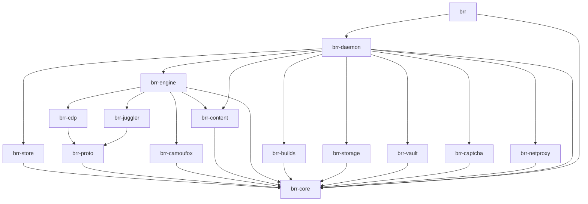

# brr implementation map

This is the companion to the requirements spec. It names the code units so that epics and issues can give every builder exact paths. A crate boundary is also the parallelism boundary: two agents never edit the same crate in the same wave.

## Repository layout

```
Cargo.toml                 workspace; shared deps in [workspace.dependencies]; edition 2024
crates/
  brr-core/                domain types, ULID ids, Error (Appendix G), Capability, events (Appendix D),
                           FSM transition tables (Appendix J), OperationSpec registry metadata, settings/defaults (§20)
  brr-store/               SQLite (rusqlite bundled + rusqlite_migration), schema (§7.5), repositories, secret table
  brr-proto/               pipe transport: spawn child with fd 3 (in) / fd 4 (out), NUL-delimited JSON (command-fds);
                           generic request/response/event multiplexer (id allocation, session routing)
  brr-cdp/                 CDP client on brr-proto (pipe) or WebSocket (Live browsers); flat sessions, Target auto-attach,
                           serde_json params plus small typed structs where read; per-Client session multiplexing
  brr-juggler/             Juggler client on brr-proto; Browser/Page/Runtime/Network/Input/screencast subset
  brr-camoufox/            Camoufox launcher port: fpgen fingerprint, chunked CAMOU_CONFIG_n / CAMOU_PREFS_n env,
                           FONTCONFIG_FILE, fonts bundle, geoip
  brr-engine/              Driver trait; chromium + camoufox drivers; injected script (built by bun from Playwright
                           sources at build time, embedded); actionability port; Tab tool implementations; screencast
  brr-builds/              Build sources (CfT, headless-shell, ungoogled, fingerprint-chromium, brave, edge, camoufox),
                           resumable install with checksum, system detection, channels, GC
  brr-storage/             Artifact backends: local, S3-compatible, R2 preset (object_store, aws feature); presign
  brr-vault/               XChaCha20-Poly1305 AEAD; key source fixed at vault creation (keyring or 0600 file); TOTP; age passphrase archives
  brr-captcha/             detection scripts, provider trait, 2captcha client, budget accounting
  brr-content/             readability/markdown (dom_smoothie), adblock engine (single-thread, owned by one task) + list updater,
                           autoconsent bundle asset
  brr-netproxy/            per-Instance forwarding proxy (auth upstream), proxy health check
  brr-daemon/              services, Instance owner tasks, Clients/Leases, Admission/limits, Reaper, retention, process
                           supervision (subreaper + BRR_INSTANCE_ID env-marker reconciliation), HTTP (axum), SSE,
                           MCP (rmcp, stateless HTTP + stdio), WS relays (screencast, /cdp, extension relay), rust-embed UI
  brr/                     the binary: clap CLI generated from registry, `brr daemon`, `brr mcp`, `brr doctor`, `brr prime` (agent guide, cli/prime.md), `brr skill` (embeds skills/brr/SKILL.md)
web/                       SvelteKit (adapter-static) + openapi-typescript + openapi-fetch; embedded by brr-daemon
extension/                 Chrome MV3 companion extension (TypeScript, bundled with bun)
tests/live/                live test scripts (bash + curl + jq)
```

## Dependency direction



## The operation registry contract (brr-core)

- `OperationSpec` is pure metadata in brr-core:
  - `name` (`<group>.<verb>`)
  - `group`, `toolset`, `summary`
  - `http: (Method, &str path)`
  - `cli: &[&str]`
  - `mcp_tool: Option<&str>`
  - `read_only: bool`
  - `capability: Option<Capability>`
  - `input_schema` / `output_schema: fn() -> schemars::Schema`
- Registration is distributed. The brr-daemon module that implements an operation declares its `static SPEC: OperationSpec` and calls `inventory::submit!(OpRegistration { spec: &SPEC, handler })`. `brr_daemon::ops::all()` collects them. There is no central list.
- Handler signature: `fn(Ctx, serde_json::Value) -> BoxFuture<'static, Result<serde_json::Value, Error>>`.
  - REST mounts one axum route per spec; OpenAPI is generated from `all()`.
  - MCP lists one tool per spec that has `mcp_tool`, filtered by toolset.
  - The CLI builds clap subcommands from `all()` (same binary) and calls `POST /v1/ops/{name}` over the unix socket.
- The parity test iterates `all()`. It asserts that each spec has a REST route, a CLI path, and an MCP tool unless explicitly exempt (streams, WS), and that names, paths and tools are unique.

## Conventions every builder follows

- Edition 2024, `tokio` multi-thread, `thiserror` in libs, `anyhow` only in the `brr` binary.
- `tracing` for logs; no `println!` outside the CLI.
- Never `unwrap()` on I/O or protocol data; protocol errors map to `Error`.
- Tests go next to the code (`#[cfg(test)]`) or in `crates/<c>/tests/`.
- Browser-dependent tests read the `BRR_TEST_CHROME` env var (path to a Chromium-family binary) and skip with a printed reason when it is unset. Never assert host state.
- Secrets never go into `Debug` output (wrap them in `secrecy::SecretString`).
