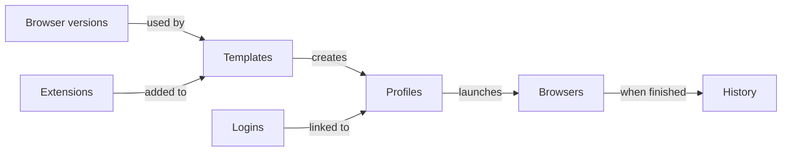

# Web UI redesign

Status: draft for review (2026-11-16, revision 2). Extends §21 of
`2026-11-12-browser-manager-requirements.md`; once accepted, §21 and `GLOSSARY.md` are updated to
match in the same change (bead `brr-2ij.9`).

## 1. Problem

The current UI is complete in features but hard to use for someone new to brr:

- 14 flat nav items. Configuration lives on six pages (Proxies, Captcha, Capacity, Storage,
  Settings, Browser versions) next to daily work, so it is unclear where to start.
- Templates are a tab hidden inside Profiles, and a Template cannot carry extensions, so
  "set up once, reuse" is not possible.
- A finished browser run shows almost nothing: the settings, Template, proxy, Logins, captcha cost
  and files of that run are not in one place, and the settings it ran with are not stored at all.
- The Dashboard shows counts but no costs, balances, failures or trends.
- Nothing tells a new user what to do first.

## 2. Decisions (agreed 2026-11-16)

| Topic | Decision |
|---|---|
| UI stack | SvelteKit with the hand-written kit in `web/src/lib/ui`. No new npm package. shadcn/ui, Kibo UI and Dice UI are React registries and serve as design references only (settings dialog, stat cards, empty states). "aresa-ui" could not be found. |
| Profile vs Template | Copy semantics stay (GLOSSARY "Profile template"). A Template gains **extensions**, copied to the Profile when it is created. |
| Logins | Linked to Profiles, not Templates: a login belongs to the account whose cookies live in that Profile's data. |
| Run history | A migration stores, per Instance, what it actually ran with (settings, Template, extensions, resolved proxy). |
| Delivery | This spec, user review, then the waves in §11, one bead per slice. |

## 3. Words shown to users

GLOSSARY terms stay in code, API, CLI and MCP. The UI uses these consistently:

| UI word | GLOSSARY term | Meaning |
|---|---|---|
| Browser | Instance | a running browser, managed or attached |
| Run | Instance (any state) | one browser from start to end |
| Profile | Profile | stored browser data (the user data folder: cookies, history, site storage) |
| Keeps data / Fresh each time | Persistent / Ephemeral profile | the Profile kind |
| Template | Profile template | reusable configuration: version, display, proxy, extensions, locale, captcha, idle |
| Browser version | Build | an installed or registered browser |
| Login | Credential | a stored username/password/TOTP |
| Keep this run's data | Promote | turn a fresh-each-time run into a Profile that keeps data |

## 4. Information architecture

Sidebar: 8 items in 2 groups, plus a **Settings** button at the sidebar foot that opens the
Settings dialog over the current page. The top bar keeps the capacity pill, theme toggle and
notification bell; the bell's links point at the new routes. The sidebar still collapses below
1024 px. `/design` stays a dev-only route outside the nav.

| Group | Item | Route | Replaces |
|---|---|---|---|
| Work | Overview | `/` | `/` Dashboard |
| Work | Browsers | `/browsers`, `/browsers/[id]` | `/instances` (non-final), `/instances/[id]` |
| Work | History | `/history` (tabs Runs, Activity, Files), `/history/[id]` | finished `/instances`, `/events`, `/files` |
| Library | Profiles | `/profiles`, `/profiles/[id]` | `/profiles` |
| Library | Templates | `/templates`, `/templates/[id]` | `/profiles?tab=templates`, `/templates/[id]` |
| Library | Extensions | `/extensions` | same |
| Library | Logins | `/logins` | `/credentials` |
| Library | Browser versions | `/versions` | `/builds` |

- Old routes redirect (`+page.ts`, `redirect(308, …)`), keeping query strings: `/instances/[id]`
  goes to `/browsers/[id]`, `/events` to `/history?tab=activity`, `/proxies` to
  `/?settings=proxies`, and so on for every deleted route.
- `/browsers/[id]` for a finished run redirects to `/history/[id]`, and `/history/[id]` for a
  run still going redirects to `/browsers/[id]`, so a shared link always lands right.
- `?settings=<section>` on any route opens the Settings dialog at that section; closing it removes
  the parameter. "Fix" links in alerts use it.

## 5. Screens

Rules for every screen and every Settings section: empty, loading and error states; at most 3
filled buttons; row actions in the existing `Menu`; every destructive action confirms and says
what is removed and what is kept (§6); live updates over SSE as today.

### 5.1 Overview

Answers "is everything fine, what is running, what does it cost?".

1. **Get started** checklist, shown until every step is done or the user dismisses it
   (`localStorage`): browser version available → Profile created → first run → agent connected
   (any `mcp`/`rest` Client seen). Each step has one action. Built-in Templates count as the
   Template step, so it is not listed.
2. **Needs you** (hidden when empty): Tabs awaiting a human, failed login checks, captcha budget
   ≥ 80 % spent, provider balance below 3 days of the 7-day average spend, Profile over quota,
   free disk below `retention.free_disk_floor_gb`, failed backup, unhealthy proxy used by a
   Template or Profile, failed version install. Each row has one action: Open, Retry or Fix
   (opens the matching Settings section).
3. **Stat strip**: browsers running / capacity, open tabs, queued launches, RAM and CPU against
   the adaptive thresholds, captcha spend today against the daily budget, provider balance with
   "updated N min ago".
4. **Usage chart**: browsers running over 24 h or 7 d, stacked by engine (attached browsers as
   their own series). Hand-built SVG with a visually hidden data table for screen readers.
5. **Spend chart**: captcha spend per day for 7 days, with solves and success rate.
6. **Running now** (up to 5) and **Recent runs** (last 5 finished, with end reason), each linking
   to the full list.
7. No browser version at all: the existing "No browser yet" panel (§21 flow 2) replaces 3–6.

### 5.2 Browsers

Non-final Instances: Profile, Template, version, display, tabs, clients, idle-for, RAM, state.
Attached browsers show an "Attached" badge and no Profile.

- Primary: **Launch** (pick a Profile; "New profile…" link inside the dialog) and **Attach**
  (existing `ConnectDialog`).
- Row menu: Open, Stop (confirm; the confirm names other clients holding leases), Keep this run's
  data (fresh-each-time runs only; asks for the new Profile name), Detach (attached only).
- Detail `/browsers/[id]`: existing live view, tabs, leases and timeline, plus a collapsible "Run
  details" side panel built from the same `RunSummary` as History.

### 5.3 History

Top tabs, kept in the URL (`?tab=`):

- **Runs**: finished runs, newest first, paged. Filters: Profile, Template, end reason, date range.
- **Activity**: today's `/events` page unchanged in behavior (filters, export JSON).
- **Files**: today's `/files` page unchanged in behavior; includes files of one-off jobs that
  have no run.

A notice states how long history is kept (`retention.events_days`, which also sweeps finished
Instance rows), with a "Change" link to Settings → Storage.

Run detail `/history/[id]` tabs:

| Tab | Content | Source |
|---|---|---|
| Summary | start, end, duration, end reason, error, version, display, Profile (link, or name if deleted), clients that leased it | `instance`, `lease`, `client` |
| Settings | the settings it ran with, read-only, in the same section layout as the Template editor; toggle "Show changes since" highlights fields that differ from the Profile now | `instance.settings` (B1) |
| Template & extensions | Template name (link while it exists), extensions with the version loaded | B1 |
| Network | proxy actually used (pool members rotate), its exit IP and country at the time if known | `instance.proxy_id` (B1), `proxy` |
| Logins | each `login.performed`: site, username, result, time | events, joined to `credential` for site and username |
| Captcha | solves of the run: site, type, result, cost, duration; total cost | `captcha_solve` joined on the run's tabs |
| Files | the run's Artifacts with preview and download | `artifact.instance_id` |
| Activity | the run's events | events with subject = this Instance or its Tabs |

Runs older than the B1 migration have no snapshot: those tabs say "Not recorded for runs before
<version>". Attached runs show only Summary, Network (none), Files and Activity.

### 5.4 Profiles

Table: name, kind, Template it came from, last run, disk use (Over quota badge), login status.

- Primary: **New profile** (dialog: choose Template, name, kind; then the Profile opens),
  **Import**.
- Row menu: Launch, Duplicate, Export, Back up now, Delete.
- Detail `/profiles/[id]` tabs (in the URL):
  - **Overview**: kind, data folder, disk use and quota, Template it came from, last 5 runs.
  - **Settings**: the shared section editor (§8), Extensions section included. Banner: "Copied
    from Template X on <date>. Changing the Template does not change this Profile."
    Menu action **Re-apply template…** (B9) previews the field changes and asks to confirm;
    disabled with a reason when the Template was deleted.
  - **Logins & checks**, **Cookies & bookmarks**, **Backups**: today's sections, unchanged in
    behavior.

### 5.5 Templates

Cards in two groups, Built-in and Yours: engine, display, proxy, extension count, Profiles made
from it.

- Primary: **New template** (dialog: start from a built-in or blank engine choice, name; then the
  editor opens).
- Card menu: Edit (Duplicate for built-ins), Duplicate, New profile from this, Delete.
- Editor `/templates/[id]`: sections Browser version, Display, Network & proxy, Locale &
  fingerprint, Extensions, Captcha, Content, Idle, Storage; built-ins read-only with a
  "Duplicate to edit" action. Save uses `SaveBar`; leaving with unsaved changes asks to discard.

### 5.6 Extensions

Library: name, engine, source, version, Templates using it, Profiles using it.

- Primary: **Add extension**.
- Row menu: Update, **Add to templates…** (dialog: checkboxes of user Templates of the same
  engine; built-ins are not listed), Remove.

### 5.7 Logins

Site, username, linked Profiles, last check result. No secret ever in the DOM.

- Primary: **Add login**, **Import CSV**.
- Row menu: Edit, Link to profiles, Delete.

### 5.8 Browser versions

Installed and registered (version, engine, capabilities, used by Templates and Profiles, size)
and Available per source with install progress.

- Primary: **Install**, **Detect installed browsers**.
- Remove: refused while in use, and the dialog lists the Templates, Profiles and runs using it.

### 5.9 Settings dialog

Large modal: section list left, section body right, body scrolls; sized
`min(1100px, 95vw) × min(760px, 90vh)` so it fits 1280×800. Each section saves on its own through
the op it uses today and shows `SaveBar` when dirty. Switching section or closing with unsaved
changes asks to discard. Child dialogs (Add proxy, Import, Clean now) stack as native modals; Esc
closes only the top one. Fields that need a daemon restart (`server.bind`, `server.socket`) say
so next to the field. Rarely changed fields sit under an "Advanced" disclosure.

Every `Settings` field has exactly one home:

| Section | Fields and content | Advanced | Saves through |
|---|---|---|---|
| General | `ui.theme` (also in the top bar), About, health check (`system.doctor`) | `server.*`, `vault.key_source` (read-only) | `settings.set` |
| Proxies | proxies, pools, health, bulk import, in-use dialog | `proxy.health_interval_min`, `proxy.check_url` | proxy/pool ops, `settings.set` |
| Captcha | provider key (set/replace/remove), `captcha.default_policy`, `daily_usd`, `daily_solves`, balance, solve log, 7-day spend chart | `captcha.provider_url`, `human_wait_s` | `captcha.settings_set` |
| Idle & resources | `idle.*`, `adaptive.*`, `instance.auto_restart` | `instance.start_timeout_s`, `stop_timeout_s`, `tab.*` buffers, `login_check.interval_min` | `settings.set`, `limits.set` |
| Capacity | `limits.*`, `admission.*`, current queue | `lease.exclusive_wait_s` | `limits.set`, `settings.set` |
| Storage | backend config and Test, usage, `retention.*` (shown as "keep history N days" for `events_days`), Clean now, backup passphrase, `backup.keep` | `artifacts.url_ttl_s`, `results.inline_max_mb` | `storage.backend_set`, `retention.set`, `settings.set` |
| Agents | connect snippets (MCP stdio and HTTP, REST, Playwright), `mcp.default_toolsets` (B8), connected clients, `oneshot.*` | `client.*` idle timeouts | `settings.set` |
| Updates | `builds.check_at`, `content.adblock_lists` | `builds.github_api`, `builds.edge_repo`, `extensions.cws_update_url`, `extensions.amo_api` | `settings.set` |

## 6. Confirmations

| Action | Confirm says |
|---|---|
| Delete Profile | data folder and its runs' files are deleted; backups are kept; refused while running |
| Delete Template | Profiles made from it keep their settings |
| Remove extension | lists the Templates and Profiles that lose it |
| Delete Login | lists linked Profiles and login checks that stop working |
| Remove browser version | refused while in use, with the list; otherwise frees N GB |
| Delete proxy / pool | refused while in use, with the list (existing `InUseDialog`) |
| Stop browser | names other clients holding leases; unsaved fresh-each-time data is lost unless kept |
| Re-apply template | the field-by-field diff from B9 |
| Remove captcha key | automatic solving stops |
| Close Settings with changes | which sections have unsaved changes |

All go through the existing `confirm()` helper and `ConfirmHost`, except Re-apply, which needs
the diff body and uses `Dialog`.

## 7. Backend changes

| # | Change | Why |
|---|---|---|
| B1 | Migration `0005_history.sql` on `instance`: `settings` JSON, `template_id`, `template_name`, `extensions` JSON (`[{id, name, version}]`), `proxy_id`; all filled in the launch transaction, null for attached browsers and old rows | History Settings, Template, Network tabs |
| B2 | `profile.template_name`, filled at creation, so the source stays named after the Template is deleted | Profiles table, History |
| B3 | `template_extension(template_id, extension_id, pinned_version, auto_update)`; `template.create/update/get/save_from_profile` carry the list; `profile.create` copies it into `profile_extension`. Saving refuses an extension whose engine differs from the Template's engine, naming it | Templates own extensions |
| B4 | `extension.list` returns `template_ids` beside `profile_ids`; `extension.remove` deletes `template_extension` rows | Extensions table, removal confirm |
| B5 | `instance.list` gains `template`, `end_reason`, `since`, `until` filters and a cursor for finished runs | History filters and paging |
| B6 | `captcha.stats{days ≤ 30}`: per day spend, solves, failures (`GROUP BY` on `captcha_solve`) | Overview and Captcha charts |
| B7 | `usage.history{window: 1d\|7d}`: browsers running per bucket by engine, from `instance` start/end overlap (bucket 1 h for 1d, 6 h for 7d) | Overview usage chart |
| B8 | `mcp.default_toolsets` (list, default = today's full set); an MCP session without `?toolsets=` uses it | Settings → Agents |
| B9 | `profile.reapply_template{profile_id, dry_run}`: returns the field diff; without `dry_run` writes it. `Conflict` when the Template is gone or the Profile is running | Profile "Re-apply template" |
| B10 | `captcha.balance` caches the provider answer for 10 minutes and returns `fetched_at`; `refresh: true` bypasses the cache | Overview polls it; every call is a provider request today |

- All new ops go through the registry, so REST, CLI and MCP follow (parity test).
- The B1 snapshot holds no new secret: `ProfileSettings` already comes back from `profile.get`,
  proxy passwords stay in `secret`, Logins are referenced by id.
- After wave 1, `web/src/lib/api/schema.d.ts` is regenerated (`gen:api:file`) before wave 3.

## 8. Shared components

Reuse first: `Dialog`, `confirm`/`ConfirmHost`, `Table`, `PagedFooter`, `Menu`, `Card`, `Tabs`,
`SaveBar`, `EmptyState`, `Skeleton`, `Badge`, `StatusDot`, `StateBadge`, `KeyValue`, `PageHeader`,
`Progress`, `SegmentedControl`, `Select`, `Switch`, the `profiles/sections/*` editors, and the
existing feature dialogs (`proxies/*`, `credentials/*`, `builds/*`, `storage/*`, `instances/*`).

New, each used in 2+ places:

| Component | Used by |
|---|---|
| `ui/StatCard` (label, value, sub-line, tone, optional link) | Overview strip, Captcha section, Storage section |
| `ui/BarChart`, `ui/AreaChart` (SVG, theme tokens, hidden data table) | Overview usage and spend, Captcha section |
| `ui/SettingsDialog` (section nav, body, dirty guard, `?settings=` sync) | Settings |
| `ui/Disclosure` ("Advanced") | Settings sections, config sections |
| `ui/DetailLayout` (header, URL-synced tabs, optional side panel) | Browser, History run, Profile, Template detail |
| `config/sections/*` (today's `profiles/sections/*`, moved, with a `readonly` prop) | Template editor, Profile settings, History Settings tab |
| `runs/RunTable`, `runs/RunSummary` | Overview, Browsers, History, Profile overview |
| `extensions/ExtensionPicker` (engine-filtered) | Config Extensions section, Add to templates dialog |
| `settings/sections/*`, one per §5.9 row | Settings dialog only |

Pages whose content moves (`/proxies`, `/captcha`, `/limits`, `/storage`, `/settings`,
`/connect`, `/events`, `/files`, `/instances`, `/builds`, `/credentials`) are deleted after the
move; their logic moves into the components above, not copied.

## 9. Acceptance

- Nav shows 8 items; every deleted route redirects (one Playwright test walks the list);
  `?settings=<section>` opens each section.
- First-user flow, one Playwright test with an empty data dir: detect or register a browser
  version → create a Template with a proxy and an extension → create a Profile from it → launch
  → stop → the run appears in History with its settings, Template, extension version, proxy and
  files.
- Every row in §6 shows its confirm with the stated content.
- Every Settings field is reachable in exactly one section (test reads `settings.get` keys and
  checks each has a field).
- §21 acceptance on every route and every Settings section: light and dark, axe-clean, at most 3
  filled buttons, 1280×800 without horizontal scroll, empty/loading/error states, no secret in
  the DOM.
- `just verify` green.

## 10. Out of scope

- Live Template → Profile inheritance (rejected in §2).
- Network traffic charts (needs byte counting in `brr-netproxy`; separate spec).
- Peak RAM per run (not sampled today).
- Any new npm package.

## 11. Waves

Two agents never edit the same crate or route directory in one wave.

| Wave | Slices (bead) | Owner area | Needs |
|---|---|---|---|
| 1a | B1, B2, B5 history data (`.1`); B3, B4 template extensions (`.2`); B6, B7, B10 stats (`.3`); B8 toolsets (`.4`) | one backend agent, in that order (`brr-store`, `brr-daemon`, `brr-core`) | — |
| 1b | Shell, nav, redirects, `SettingsDialog` with all sections moved (`.5`) | `web/` | no new API |
| 2 | Overview (`.6`); Browsers and History (`.7`); Profiles, Templates, Extensions, Logins, Versions (`.8`) | `web/`, split by route and `lib/` directory | 1a merged, schema regenerated |
| 3 | B9 and Re-apply UI, first-user flow, §21 and GLOSSARY updates (`.9`) | all | 2 |
