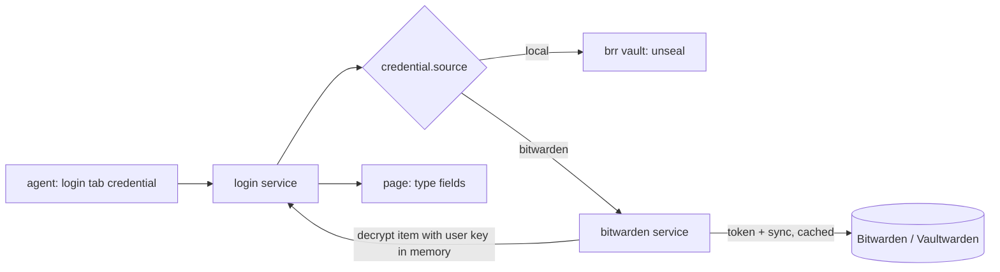

# Bitwarden as a login provider

Status: approved (2026-11-17), crates approved; build after the sandbox ships.

## 1. Goal

`login` (MCP/REST/CLI) can type a login that lives in the user's Bitwarden (or Vaultwarden) vault,
not only one stored in brr's own vault. The secret is fetched when the login runs and never
written to brr's database; the agent never sees it (same guarantee as today, spec §login).
Bitwarden items are linked to Profiles like local credentials, and login checks with
`auto_relogin` can use them.

## 2. Discovery

### 2.1 Local code (file:line, read 2026-11-17)

| What | Where |
|---|---|
| Credential row (sealed fields) | `crates/brr-store/src/migrations/0001_*.sql:17-20` (`credential`, `credential_profile`) |
| Store access | `crates/brr-store/src/credential.rs` |
| Unsealed credential handed to the login flow | `crates/brr-daemon/src/services/credentials/mod.rs:21-28` (`Unsealed`), `:151-167` (`unseal`) |
| Credential view (no secrets) | `crates/brr-core/src/model.rs:1030-1041` (`Credential`) |
| Credential ops | `crates/brr-daemon/src/ops/credentials.rs:27-99` (`credential.list/create/update/delete/import`) |
| Login flow (origin vetting, field filling, TOTP timing) | `crates/brr-daemon/src/services/login/mod.rs:332-421` (`prepare`, `login`); `vetted_origin` `:159-165` |
| TOTP from otpauth URI or base32 | `crates/brr-vault/src/totp/mod.rs:12-45` |
| brr's own secret sealing (AEAD, key source) | `crates/brr-daemon/src/services/secrets/mod.rs`, `crates/brr-vault/src/lib.rs` |
| Login checks with `credential_id`, auto re-login | `crates/brr-core/src/model.rs:1044-1055`, `crates/brr-daemon/src/ops/login_checks.rs` |
| Crypto already approved | `Cargo.toml:54-57` (`sha2`, `aes`, `cbc`); `reqwest`, `zeroize`, `base64` approved |
| Settings dialog sections | `web/src/lib/settings/sections.ts` |
| Logins page | `web/src/routes/logins/` |

### 2.2 Remote facts

Measured 2026-11-17 against a throwaway Vaultwarden 1.37.5 (web vault 2026.10.1, served over
self-signed TLS on localhost because the web vault refuses `http:` server URLs) with two accounts
created in the web vault: PBKDF2 (default) and Argon2id; the Argon2id account owns an organization.
Raw responses and the plaintexts typed in are in `crates/brr-bitwarden/tests/fixtures/{pbkdf2,argon2}/`
(`prelogin.json`, `token.json`, `sync.json`, `expected.json`). An independent Python decryptor
(`cryptography` + `argon2-cffi`) following the rows below decrypted every item of both fixtures to
exactly `expected.json`.

| Fact | Status |
|---|---|
| Personal API key login: `POST {identity}/connect/token` form `grant_type=client_credentials&scope=api&client_id=user.<uuid>&client_secret=…&deviceType=21&deviceIdentifier=<uuid>&deviceName=brr` → 200 JSON with PascalCase `Kdf` (0 = PBKDF2, 1 = Argon2id), `KdfIterations`, `KdfMemory` (MiB, `null` for PBKDF2), `KdfParallelism` (`null` for PBKDF2), `Key` (EncString type 2, the user key under the stretched master key), `PrivateKey` (EncString type 2 under the user key), plus snake_case `access_token`, `expires_in` (7200), `token_type` `Bearer`, `scope` `api`. Also present: `AccountKeys.publicKeyEncryptionKeyPair.wrappedPrivateKey` (= `PrivateKey`), `UserDecryptionOptions.MasterPasswordUnlock{Kdf{KdfType,Iterations,Memory,Parallelism}, MasterKeyEncryptedUserKey (= Key), Salt (= email)}`, `ForcePasswordReset`. deviceType 21 shows as `devicetype: "SDK"` in the JWT | measured (Vaultwarden) |
| Measured KDF values: PBKDF2 600000 iterations; the web vault's Argon2id defaults were memory 32 MiB, iterations 6, parallelism 4 | measured |
| Bad credentials: wrong `client_secret` → 400 `{"message":"Incorrect client_secret",…,"error":"","object":"error"}`; unknown `client_id` → 400 `"Invalid client_id"`. Bad bearer on `/api/sync` → 401 with an HTML body (not JSON) | measured (Vaultwarden) |
| API key login with a never-seen `deviceIdentifier` returned 200 and a token directly; no new-device verification and no 2FA prompt (accounts without 2FA, no SMTP configured). bitwarden.com behavior still unverified | measured on Vaultwarden; assumed for bitwarden.com |
| `POST {identity}/accounts/prelogin` `{"email"}` → camelCase `{kdf, kdfIterations, kdfMemory, kdfParallelism, kdfSettings{…}, salt: null}`; not needed when the token response carries the KDF | measured |
| `GET {api}/sync?excludeDomains=true` (camelCase JSON): top level `ciphers, collections, domains (null), folders, object, policies, profile, sends, userDecryption`. `profile` has `email`, `key` (= token `Key`), `privateKey` (= token `PrivateKey`), `accountKeys`, `organizations[]` with `id`, `name` (plaintext) and `key`. `userDecryption.masterPasswordUnlock{kdf, masterKeyEncryptedUserKey, salt}` repeats the KDF | measured |
| Ciphers: `type` 1 = login; `organizationId` (null for personal), `collectionIds`, `deletedDate` (trashed items stay in sync with a timestamp and must be skipped), `key` (per-item cipher key, EncString type 2; the 2026.10 web vault set it on **every** item, personal and org), `name`, `login{username, password, totp, uri, uris[{uri, uriChecksum, match}], passwordRevisionDate}`. `login.uri` duplicates `uris[0].uri`; `uriChecksum` is an encrypted checksum; `match` was null. `login.totp` decrypts to the text as typed: base32 (`JBSWY3DPEHPK3PXP`) or a full `otpauth://totp/…` URI; null when unset | measured |
| Sync without a `Bitwarden-Client-Version` header returns 200 with identical ciphers (Vaultwarden only logs an `Unauthorized Error: No Bitwarden-Client-Version header provided` line); sending a version changed nothing for 2023.12.0 … 2026.10.0 | measured (Vaultwarden) |
| Decryption: master key = PBKDF2-SHA256(password, lowercase email, n, 32) or Argon2id(password, salt = SHA-256(lowercase email), t = `KdfIterations`, m = `KdfMemory` × 1024 KiB, p = `KdfParallelism`, 32); stretched key = HKDF-Expand-SHA256(master key, info `enc`, 32) ‖ HKDF-Expand(…, `mac`, 32); `Key` decrypts to the 64-byte user key (32 enc ‖ 32 mac). EncString type 2 = `2.<b64 iv>|<b64 ct>|<b64 mac>`, MAC = HMAC-SHA256(mac key, iv ‖ ct), AES-256-CBC with PKCS#7. `PrivateKey` decrypts to a PKCS#8 DER RSA-2048 key. Item fields decrypt with the item key, which itself decrypts with the user key (personal) or org key (organization) | measured |
| EncString types seen: `2` everywhere symmetric; `4` (`4.<b64>`, no `|` parts) only for `organizations[].key` | measured |
| Organization items: org key = RSA-OAEP with SHA-1 (MGF1-SHA-1) of the 64-byte org key under the user's private key (EncString type 4) | measured |
| Vaultwarden implements the same identity/sync API | measured (field shapes above); bitwarden.com cloud not yet captured |
| `bw` CLI needs the master password to unlock in every login method; `bw serve` exposes a local REST API | measured in docs (bitwarden.com/help/cli) |
| Bitwarden Secrets Manager stores key/value secrets, not website logins with URIs/TOTP | measured in docs |

Still assumed: bitwarden.com cloud matches Vaultwarden's shapes and does not demand new-device
verification for API key logins; casing of cloud responses (Vaultwarden returns PascalCase for the
token response, camelCase elsewhere; parse case-insensitively to be safe).

## 3. Current state

brr stores credentials only in its own SQLite vault, each field sealed with brr's key; `login`
unseals one into `Unsealed` and types it. There is no external provider. This plan adds a
Bitwarden provider (connection settings + unlock state), a credential *source* (`local` or
`bitwarden` with an item id), on-demand fetch into the same `Unsealed`, linking Bitwarden items to
Profiles, and UI for connect/unlock/link.

## 4. Architecture



- **Provider = connection, not a copy.** brr keeps a credential row per linked Bitwarden item with
  `source = bitwarden`, `bitwarden_item_id`, site and username *hint* (display only), selectors,
  Profile links and login history — the same row shape so ops, login checks and the UI keep working.
  Password and TOTP are never stored; they are decrypted from the latest sync at login time.
- **Unlock state lives in memory.** After unlock the daemon holds the user symmetric key (64 bytes,
  zeroized on drop/lock) and the access token. Restart = locked, unless the master password is
  kept (Q2).
- **Sync** on unlock, then when an item id is missing or stale, at most every N minutes (setting);
  the encrypted sync payload stays in memory only.
- **Origin rule unchanged:** a Bitwarden item is typed only into a page whose origin matches one
  of the item's URIs (Bitwarden match rules reduced to brr's existing `vetted_origin` origin match).

## 5. Flows

**Connect (Settings → Logins → Bitwarden):** server URL (bitwarden.com / EU / self-hosted), API
`client_id` + `client_secret`, master password → `bitwarden.connect` → token, sync, KDF, user key →
secrets sealed in brr's vault → status `unlocked`, item count. At daemon start and every
`sync_interval_min` the daemon re-opens the vault from the sealed secrets.

**Link:** Logins page "Add from Bitwarden" lists sync'd login items (name, first URI, username) →
pick → choose Profiles → creates `credential` rows with `source=bitwarden`.

**Login:** `login.run` → `credentials::unseal` → source bitwarden → `Vault::login(id)` → not open
⇒ `Error::BitwardenLocked` ("connect Bitwarden in Settings → Logins, or check `bitwarden.status`
for the last error"); item gone ⇒ NotFound naming the item; else username/password/totp into
`Unsealed` → existing flow.

**Disconnect:** deletes the sealed secrets and drops the open vault; linked credential rows stay and
fail with `bitwarden_locked` until reconnected (the UI asks first and lists affected Profiles).

## 6. Acceptance criteria

```
AC-1  As a user, I want brr to type a login from my Bitwarden vault, so that I keep one password manager.
      GIVEN Bitwarden unlocked and item X linked to Profile P WHEN an agent calls login(tab of P, credential X) THEN the form is filled and brr.db holds no password or TOTP of X
      Verify by: integration test against a fixture identity/sync server with known test vectors; grep brr.db in the test

AC-2  As a user, I want a clear error when Bitwarden is locked, so that the agent can ask me.
      GIVEN locked WHEN login with a bitwarden credential THEN error bitwarden_locked with how to unlock; no page input
      Verify by: daemon test

AC-3  As a user, I want TOTP from Bitwarden to work, so that 2FA sites log in unattended.
      GIVEN item with totp (otpauth URI or base32) WHEN login reaches a code field THEN a valid code is typed
      Verify by: test reusing totp vectors

AC-4  As a user, I want secrets never exposed, so that agents and logs can't leak them.
      GIVEN any bitwarden op WHEN listing, erroring, logging, emitting events THEN no password, TOTP, master password, API secret or key appears
      Verify by: test capturing logs/events/responses for a run with known secrets

AC-5  As a user, I want items whose site doesn't match never typed, so that phishing pages get nothing.
      GIVEN item URIs https://a.com WHEN the tab is on https://evil.com THEN login fails origin check
      Verify by: existing origin test parameterized over source

AC-6  As a self-hoster, I want Vaultwarden to work.
      Verify by: live test against a throwaway vaultwarden container (PBKDF2 and Argon2id accounts)

AC-7  As a user, I want a changed password in Bitwarden picked up, so that I don't re-link.
      GIVEN password changed in Bitwarden WHEN next login after sync interval or forced `bitwarden.sync` THEN new password typed
      Verify by: fixture server test
```

## 7. Types and formats (draft)

```rust
// crates/brr-core/src/settings/mod.rs
pub struct BitwardenSettings {
    pub server_url: String,           // default "https://vault.bitwarden.com"; also https://vault.bitwarden.eu or a self-hosted/Vaultwarden URL; https only
    pub sync_interval_min: u32,       // default 15, 1..=1440
}
// Sealed in brr's vault (secret table), never in settings: API client_id, client_secret, master password.
// Endpoints: vault.bitwarden.com → identity.bitwarden.com / api.bitwarden.com; vault.bitwarden.eu →
// identity.bitwarden.eu / api.bitwarden.eu; any other URL → <url>/identity and <url>/api.

// crates/brr-core/src/model.rs
pub enum CredentialSource { Local, Bitwarden }
// Credential gains:
pub source: CredentialSource,
pub bitwarden_item_id: Option<String>,

pub struct BitwardenStatus {
    pub connected: bool,
    pub unlocked: bool,
    pub email: Option<String>,
    pub items: u32,
    pub synced_at: Option<i64>,
    pub error: Option<String>,
}

pub struct BitwardenItem {            // list for linking; no secrets
    pub id: String,
    pub name: String,
    pub uris: Vec<String>,
    pub username: String,
    pub has_totp: bool,
    pub linked: Option<CredentialId>,
}
```

```rust
// crates/brr-bitwarden (new crate; deps: reqwest, serde, serde_json, base64, sha2, hmac, hkdf,
// pbkdf2, argon2, aes, cbc, rsa, sha1, zeroize, thiserror, brr-core for Secret)
pub struct Credentials { pub client_id: String, pub client_secret: Secret, pub master_password: Secret }

// One unlocked vault: access token, user key, org keys and the still-encrypted ciphers of the last
// sync. Keys zeroize on drop. Re-sync = open again.
pub struct Vault { /* private */ }
impl Vault {
    pub async fn open(http: &reqwest::Client, server_url: &str, device_id: &str, creds: &Credentials) -> Result<Vault, Error>;
    pub fn email(&self) -> &str;
    pub fn items(&self) -> Vec<ItemSummary>;          // login items (cipher type 1) only, decrypted metadata
    pub fn login(&self, item_id: &str) -> Result<Login, Error>; // decrypts secrets on demand
}
pub struct ItemSummary { pub id: String, pub name: String, pub uris: Vec<String>, pub username: Option<String>, pub has_totp: bool, pub organization: Option<String> }
pub struct Login { pub username: Secret, pub password: Secret, pub totp: Option<Secret>, pub uris: Vec<String> }

#[derive(thiserror::Error)]
pub enum Error {
    InvalidServer(String),   // bad URL
    Auth(String),            // 400/401 from identity: wrong client_id/secret
    WrongPassword,           // user key MAC fails: wrong master password
    Unsupported(String),     // KDF/EncString type brr can't handle
    NotFound(String),        // item id not in the last sync, or not a login
    Network(String),
    Protocol(String),        // unexpected response shape
}
```

Ops: `bitwarden.status` → `BitwardenStatus`; `bitwarden.connect{server_url, client_id, client_secret,
master_password}` (seals the three secrets in brr's vault, stores `bitwarden.server_url`, opens the
vault; a failure stores nothing); `bitwarden.sync` (re-opens now); `bitwarden.items{query?}` →
`BitwardenItem[]`; `bitwarden.link{item_id, profile_ids, selectors?}` → `Credential` (source
bitwarden; site = origin of the item's first http(s) URI); `bitwarden.disconnect` (deletes the
secrets, keeps linked credential rows, which then fail with `bitwarden_locked` until reconnected).
The daemon opens the vault at start and every `sync_interval_min` (named timer) when connected.
Migration 0007 rebuilds `credential` with `source TEXT NOT NULL DEFAULT 'local'`,
`bitwarden_item_id TEXT`, and nullable `username_enc`/`password_enc` (a CHECK keeps them NOT NULL
for local rows). New `Error::BitwardenLocked` (code `BitwardenLocked`, 409) with the help text from §5.

## 8. Struck / rejected

- ~~Bitwarden Secrets Manager~~: stores key/value secrets, not site logins; the user's logins are
  in the Password Manager vault.
- ~~Copy items into brr's vault (import)~~: two sources of truth; CSV import already exists.
- ~~Writing back to Bitwarden~~: brr only reads.
- ~~`bitwarden.unlock` / `bitwarden.lock` ops~~: the master password is stored (§9 Q2), so connect + sync cover it.

## 9. Decisions (user, 2026-11-17)

- ~~Q1 Access method~~ → **native Rust client**, new crate `crates/brr-bitwarden`. Needs approval
  for new crates (AGENTS.md hard stop): `hmac 0.13`, `hkdf 0.13`, `pbkdf2 0.13`, `argon2 0.6`,
  `rsa 0.10`, `sha1 0.11` (RSA-OAEP-SHA1 for organization keys). All RustCrypto, on the same
  `digest 0.11` / `sha2 0.11` generation brr already uses. Risk: `rsa` has a timing side channel
  advisory (RUSTSEC-2023-0071, Marvin); brr only decrypts its own org keys locally, so there is no
  remote oracle.
- ~~Q2 Unlock~~ → **stored**: client_id, client_secret and the master password are sealed in brr's
  vault; the daemon unlocks at start and after each token expiry without a person.
- ~~Q3 Scope~~ → **personal + organization/collection items**.
- ~~Q4 Account~~ → **dedicated** Bitwarden account or organization with only bot logins
  (documented recommendation; not enforced).
- ~~Server~~ → bitwarden.com by default; the user can enter any server URL (EU, self-hosted, Vaultwarden).

## 10. Slices

| Bead | Slice |
|---|---|
| bw.1 | Spike: fixture vectors from a throwaway Vaultwarden (PBKDF2 + Argon2id), measure §2.2 |
| bw.2 | Client: token, sync, KDF, EncString decrypt, item key, (org keys) — `crates/brr-bitwarden` |
| bw.3 | Model, settings, migration, credential source in store and ops |
| bw.4 | Daemon service: unlock state, sync cache, `unseal` dispatch, ops, CLI, errors |
| bw.5 | Web: Settings → Logins → Bitwarden; Logins "Add from Bitwarden"; source badge |
| bw.6 | Tests AC-1..AC-7, live test against Vaultwarden and the user's account |
