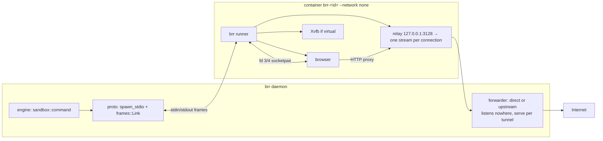

# Browser sandbox: none | docker

Status: building (2026-11-17). Decision record: [ADR 0005](../adr/0005-browser-sandbox-modes.md).

## 1. Goal

Every managed browser can run isolated from brr and the host. Settings → Sandbox picks
`sandbox.mode = none | docker` (default `none`). In `docker` mode each browser runs in its own
container that sees only its own Profile folder, run downloads and its own copies of its
extensions (read-write) plus the browser program (read-only), has no network except brr's forwarder, and has memory, CPU and
process limits.

Motivation: on ssh.aresa.me Chromium's own sandbox cannot start (`No usable sandbox!`, measured
2026-11-17) because the host sets `kernel.apparmor_restrict_unprivileged_userns=1`.

## 2. Decisions (user, 2026-11-17)

| Topic | Decision |
|---|---|
| Modes | `none` and `docker` only. Landlock, bubblewrap and Podman were considered and dropped (§10). |
| Network | No direct network; all traffic through brr's forwarder; upstream proxy credentials stay in brr. |
| Docker socket | Accepted: brr holds the Docker socket (≈ host root); brr sits behind auth. |
| Mounts | Per Profile only: its user data dir and the run's downloads dir. |

## 3. Discovery

### 3.1 Local code (file:line, 2026-11-17)

| What | Where |
|---|---|
| Launch spec built for every managed launch | `crates/brr-daemon/src/services/instances/mod.rs:325-341` |
| Live (attached) spec, never sandboxed | `crates/brr-daemon/src/services/instances/mod.rs` (`live_spec`) |
| `LaunchSpec` | `crates/brr-engine/src/lib.rs:44-62` |
| Chromium command and launch | `crates/brr-engine/src/chromium/mod.rs:121-300` |
| Camoufox command and launch | `crates/brr-engine/src/camoufox/mod.rs:184-260` |
| Pipe transport (fd 3/4 socketpairs) | `crates/brr-proto/src/pipe.rs:19-49` |
| Child dies with brr | `crates/brr-engine/src/common.rs:37-44` |
| Xvfb | `crates/brr-engine/src/xvfb/mod.rs:48-200` |
| Forwarder | `crates/brr-netproxy/src/forward/mod.rs` |
| Forwarder wired into launch | `crates/brr-daemon/src/services/proxies/mod.rs:608-635` (`for_launch`) |
| Paths | `crates/brr-core/src/paths/mod.rs` |
| Settings | `crates/brr-core/src/settings/mod.rs` |
| Doctor | `crates/brr-daemon/src/services/doctor/mod.rs` |
| Settings dialog | `web/src/lib/settings/sections.ts`, `web/src/lib/settings/sections/*.svelte` |

### 3.2 Remote facts

| Fact | Status |
|---|---|
| CDP over `docker run -i` stdin/stdout with `--cap-drop ALL --read-only --security-opt no-new-privileges --memory --pids-limit` and `--no-sandbox` answered `Browser.getVersion` | measured locally, Docker 29, image `brr:dev` |
| `--mount type=volume,…,volume-subpath=…` mounts one Profile folder rw | measured locally, Docker 29 |
| ssh.aresa.me: Docker 29.1.5, socket `root:docker 0660`, runc | measured |
| Debian trixie `docker-cli` 26.1.5 | measured (`apt-cache policy`) |
| Docker CLI 26 supports `volume-subpath` | assumed (API 1.45) |
| Juggler needs fd 3/4 to be sockets | measured (`crates/brr-proto/src/pipe.rs:20`) |
| One env string is capped at 128 KiB (MAX_ARG_STRLEN); Camoufox's config env exceeds it | measured by EngineSandbox in code; the runner spec therefore goes in a file |

## 4. Current state

brr spawns each browser directly with fd 3/4 socketpairs; it shares brr's user, files and
network. This adds `sandbox.mode`, a hidden `brr runner` that runs in the container, a
`docker run` wrapper in the engine, a direct mode and a listener-less mode in the forwarder,
docker discovery, orphan sweep, RSS, a doctor check, a Settings section and a History row.

## 5. Architecture



- The engine builds the browser command as today, then `sandbox::start` runs
  `docker run --rm -i … <image> runner` and sends the `RunnerSpec` as JSON on the run's first
  framed stream (`"spec"`); a remote run waits for `"start"` after its puts.
- Every mounted path keeps the path it has for the daemon, so argv, user-data-dir and download
  paths stay unchanged. Each path maps to the daemon's mount root that contains it: a
  named volume (`volume-subpath`) when brr runs in a container, a bind mount otherwise; a path under
  no root, or under the image's system dirs (`/usr`, `/etc`, …), is not mounted and must exist in the
  image (e.g. `/usr/bin/chromium`).
- Chromium extensions are copied into `runs/<id>/extensions/<n>` and loaded from there: Chromium
  writes indexed rulesets into an unpacked extension's folder, and the shared library must stay
  out of reach of the container. Camoufox add-ons are mounted read-only.
- The container's stdin/stdout carry frames `[stream u32 BE][kind u8][len u32 BE][payload]`
  (`brr_proto::frames`), kinds `Open`, `Data`, `Close` (end of the sender's direction) and
  `Window` (u32 BE bytes the receiver consumed). Stream 0 is the browser pipe, byte for byte. A
  payload is at most 64 KiB; a sender has at most `STREAM_WINDOW` (1 MiB) unacknowledged per
  stream, so a stream nobody reads stalls only itself, never the browser pipe.
- The browser's proxy is `http://127.0.0.1:3128` (the runner); each connection becomes a stream the
  runner opens (odd ids), which the daemon hands to the run's forwarder (`Forwarder::serve`). Even
  ids are reserved for streams the daemon opens; the runner answers them with `Close` for now.
  Direct mode refuses non-global destinations (loopback, private, link-local, CGNAT, ULA, …) with
  403, so the browser cannot reach brr's API, the host or the LAN.
- Chromium runs with `--no-sandbox`; the container is the boundary. Visible display is refused;
  virtual runs Xvfb inside the container.
- Containers are named `brr-<instance_id>` and labelled `brr.owner=<data dir>`; force stop runs
  `docker rm -f`; daemon start removes leftovers with this owner label.
- Live (attached) browsers are never sandboxed.

## 6. Flows

**Launch (docker):** `instances::launch` refuses `visible` → creates `runs/<id>` (0700) → forwarder
without a listener (upstream or direct) → `LaunchSpec.sandbox` from discovery and settings →
engine `docker run` → runner: Xvfb, relay, browser on socketpairs → CDP over stream 0 → the
launch's tunnels go to the forwarder →
`instance.sandbox = docker`.

**Stop:** `Close` on stream 0 or stdin EOF → runner stops the browser group (SIGTERM, then SIGKILL
after its grace) and exits; a browser that closed its pipe first has its output on stream 0
flushed → `--rm` removes the container. Force stop: also `docker rm -f brr-<id>`. Run dir removed
when the instance ends.

**brr crash:** stdin EOF ends the runner; leftovers removed by the sweep at next start.

**Settings change:** new launches only; saving `docker` is refused when the Docker probe fails.

## 7. Acceptance criteria

```
AC-1  As an operator, I want to choose the sandbox in Settings, so that browsers are isolated.
      GIVEN Settings → Sandbox WHEN I pick Docker and save THEN the next launch runs in a container and History shows "Sandbox: Docker"
      Verify by: e2e settings spec; live test on a scratch daemon

AC-2  As an operator, I want saving Docker refused when Docker is unusable.
      GIVEN no Docker socket WHEN I save sandbox.mode docker THEN InvalidArgument sandbox.mode naming the fix
      Verify by: live test with DOCKER_HOST pointing nowhere

AC-3  As a user, I want a sandboxed browser to see only its Profile and downloads.
      GIVEN docker WHEN the page opens file:///<data dir>/brr.db or another Profile THEN it fails; its Profile and downloads work
      Verify by: live test

AC-4  As a user, I want no network except brr's forwarder.
      GIVEN docker WHEN the page fetches http://127.0.0.1:9898/v1/system/info or a LAN address THEN it fails; https://example.com works
      Verify by: forwarder policy unit tests + live test

AC-5  As a user with a proxy, I want my proxy credentials never in the container.
      GIVEN an authenticated proxy WHEN it launches sandboxed THEN runner.json, env and mounts hold no credential; exit IP is the proxy's
      Verify by: live test

AC-6  As an agent, I want every browser tool to work the same.
      GIVEN docker WHEN navigate/snapshot/click/screenshot/pdf/download/upload_file run THEN they succeed as in none
      Verify by: live test via batch_run

AC-7  As an operator, I want no leftovers.
      GIVEN a running sandboxed browser WHEN brr is SIGKILLed and restarted THEN no brr-<id> container remains
      Verify by: live test

AC-8  As a user, I want a clear error for visible display.
      GIVEN docker WHEN launch with display visible THEN InvalidArgument display "visible display is not available in the docker sandbox; use headless or virtual"
      Verify by: live test

AC-9  As the operator of brr.aresa.me, I want browsers to launch there.
      GIVEN the deploy with docker mode THEN launch, navigate, screenshot, stop work
      Verify by: live deploy smoke test
```

## 8. Types

```rust
// brr-core
pub enum SandboxMode { None, Docker }
pub struct SandboxSettings {
    pub mode: SandboxMode,    // none
    pub image: Option<String>, // None: the image brr itself runs in
    pub memory_mb: u32,        // 2048, 256..=65536
    pub cpus: f64,             // 2.0, 0.1..=64
    pub pids: u32,             // 1024, 64..=65536
    pub shm_mb: u32,           // 1024, 64..=16384
}
// Instance gains: pub sandbox: Option<SandboxMode>  (migration 0006: instance.sandbox TEXT)
// Paths gains: runs_dir() = data_dir/runs

// brr-engine::sandbox
pub struct SandboxSpec { pub run_dir: PathBuf, pub docker: DockerTarget }
pub struct DockerTarget {
    pub image: String, pub runner: PathBuf, pub roots: Vec<MountRoot>, pub user: String,
    pub memory_mb: u32, pub cpus: f64, pub pids: u32, pub shm_mb: u32, pub owner: String,
}
pub struct MountRoot { pub path: PathBuf, pub source: MountSource }
pub enum MountSource { Bind(PathBuf), Volume(String) }
pub struct RunnerSpec {
    pub version: String, pub instance_id: InstanceId, pub argv: Vec<String>,
    pub env: BTreeMap<String, String>, pub xvfb: Option<Size>,
}
// LaunchSpec gains: pub sandbox: Option<SandboxSpec>

// brr-netproxy
pub enum Route { Upstream(Arc<Upstream>), Direct }
pub enum Listen { Loopback, None }
// Forwarder::serve(stream) takes a sandboxed run's tunnels
// Forwarder::start(route, listen); url() -> Option<String>
```

Image: `deploy/Dockerfile` adds `docker-cli`. Compose: mount `/var/run/docker.sock`, add brr's user
to the socket's group, `BRR_SANDBOX__MODE: docker`.

## 9. Guarantees

| | none | docker |
|---|---|---|
| Other files hidden | no | yes |
| Network only via brr | no | yes |
| Can't see or signal brr | no | yes |
| Memory/CPU/process limits | no | yes |
| Cost | — | brr holds the Docker socket (≈ host root) |

## 10. Struck

- ~~Landlock~~: on kernel 6.8 no UDP filtering and no signal scoping; user chose docker|none.
- ~~bubblewrap~~: needs unprivileged user namespaces, blocked on the target host.
- ~~Podman~~: not a drop-in under uncloud (rootless needs keep-id, host-path data, cgroup delegation).
- ~~Inner Chromium sandbox in the container~~: needs userns; the container is the boundary.
- ~~Runner spec in an env var~~: Camoufox's config exceeds the 128 KiB per-string limit.
- ~~Visible display in containers~~: needs the host display socket inside.
- ~~Docker Engine API client~~: the `docker` CLI matches how brr shells out to Xvfb.
